

**SOLD for US$1,000 after 13 days.** I listed a **Milk-V Pioneer Box** — one of the most powerful RISC-V desktop machines you can buy — at US$1,300 (≈ C$1,800) on October 29, 2026. It sold for US$1,000 on November 11, 2026. This was the unit I backed on [Crowd Supply](https://www.crowdsupply.com/milk-v/pioneer) during the original crowdfunding campaign. It arrived in January 2024 and had been used very little since. No known issues; it worked exactly as it should.

It was a complete, ready-to-use RISC-V PC in a standard mATX-class enclosure — not a single-board computer. If you wanted a real RISC-V workstation for native builds, distro porting, compiler and toolchain work, or CI, this was the machine.

## Why it's interesting

The Pioneer is built around the **SOPHON SG2042**, a 64-core RISC-V system chip. That makes it the most capable RISC-V desktop available, and a genuinely useful platform for working on the RISC-V ecosystem rather than just running it. It boots via UEFI and runs Fedora, Debian, Ubuntu, openKylin and other RISC-V distributions.

The [Milk-V Pioneer](https://milkv.io/pioneer) page has the full board documentation; the highlights below are what mattered for a working machine.

## The chip — SOPHON SG2042

- 64 × T-Head **C920** RISC-V cores, up to **2 GHz**
- **RVV 0.71** vector extension
- L1: 64 KB I + 64 KB D per core · L2: 1 MB per cluster · **64 MB** system L3 cache
- 4-channel DDR4-3200, ECC RDIMM / UDIMM / SODIMM
- 2 × PCIe Gen4 x16 with CCIX support
- Typical power consumption around 120 W (cooler rated to 160 W TDP)

## What was in the box

The Pioneer Box was the fully assembled, ready-to-run configuration:

| Component | Specification |
|---|---|
| Board | Milk-V Pioneer (SOPHON SG2042), mATX |
| CPU | 64-core RISC-V (C920), up to 2 GHz, RVV 0.71 |
| Memory | 128 GB DDR4-3200 (4 × DIMM) |
| Storage | 1 TB PCIe 3.0 NVMe SSD |
| Networking | 2 × 2.5 GbE on board + Intel X540-T2 (2 × 10 GbE) — **4 Ethernet ports total** |
| Graphics | AMD Radeon R5 230 (HDMI, DVI, VGA) |
| USB | 9 × USB 3.0 Type-A (8 rear, 1 front) |
| Front panel | Power button, USB 3.0, and a USB-C serial console for firmware/boot debugging |
| Expansion | 5 × SATA, 2 × M.2 M-key, PCIe slots, microSD slot |
| Power | MSI A350 350 W PSU |
| Cooling | Tower cooler with PWM fan (up to 2300 RPM, 160 W TDP) |
| Case | White compact Pioneer Box enclosure with a carry handle |

## A look at it

  <video controls preload="metadata" poster="/assets/milkv-pioneer/photo-2.jpg">
    <source src="/assets/milkv-pioneer/pioneer-box-video.mp4" type="video/mp4" />
    Your browser does not support the video tag.
  </video>

  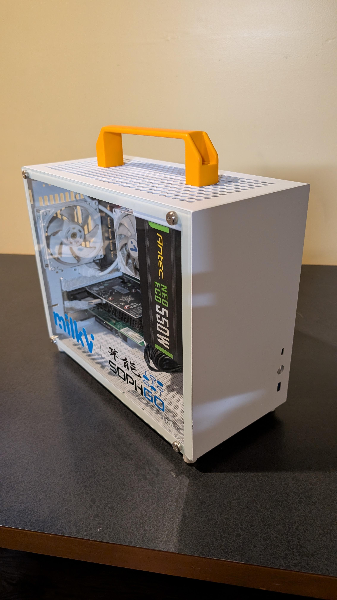
  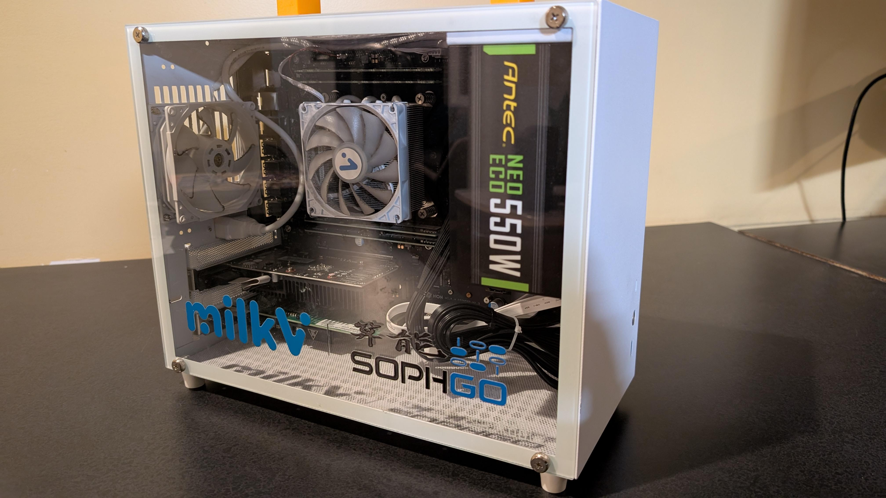
  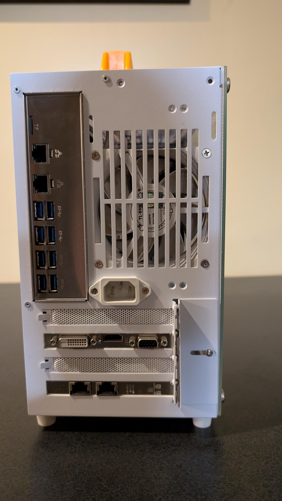
  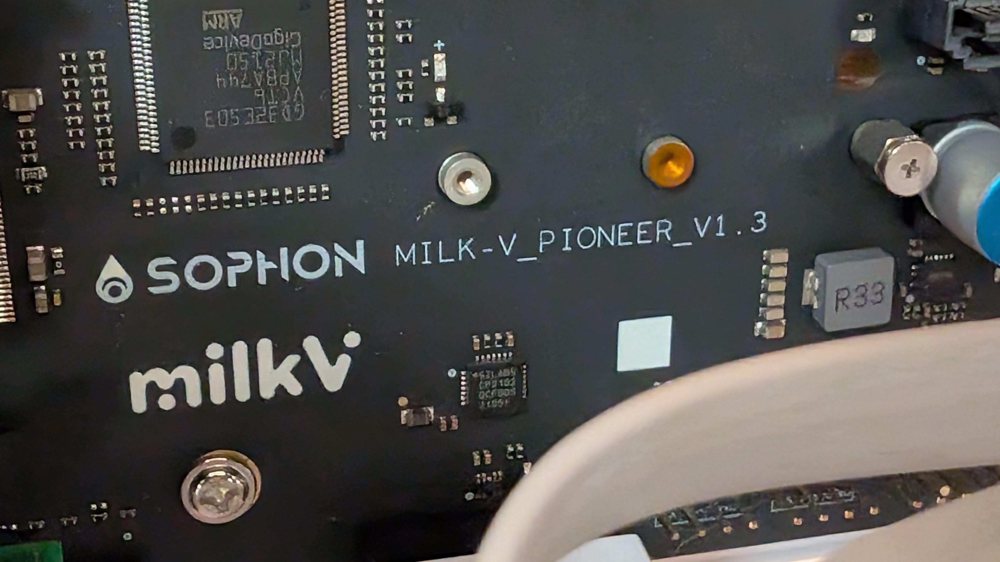
  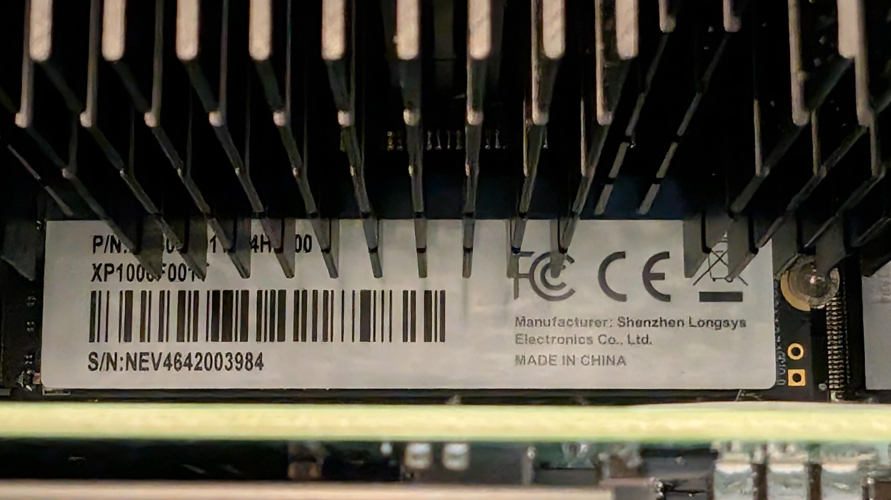
  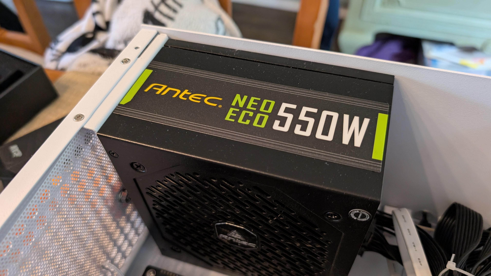
  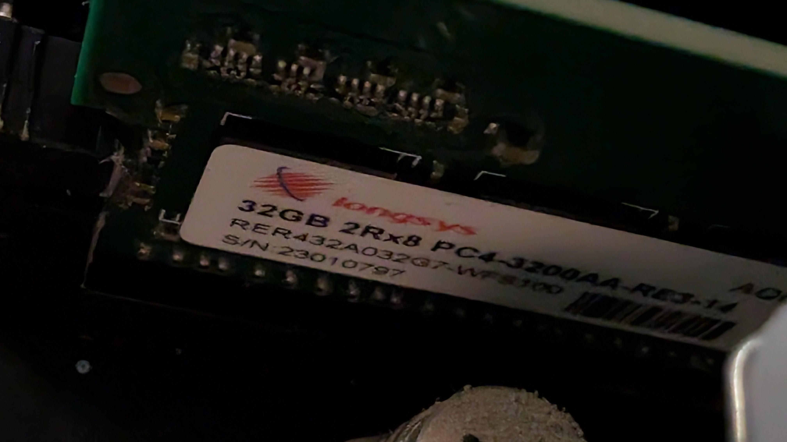
  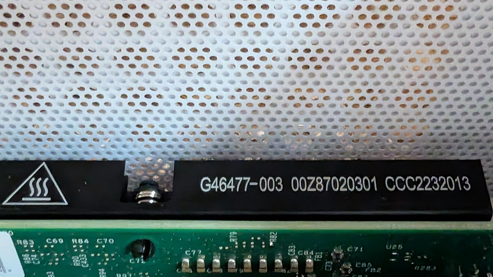
  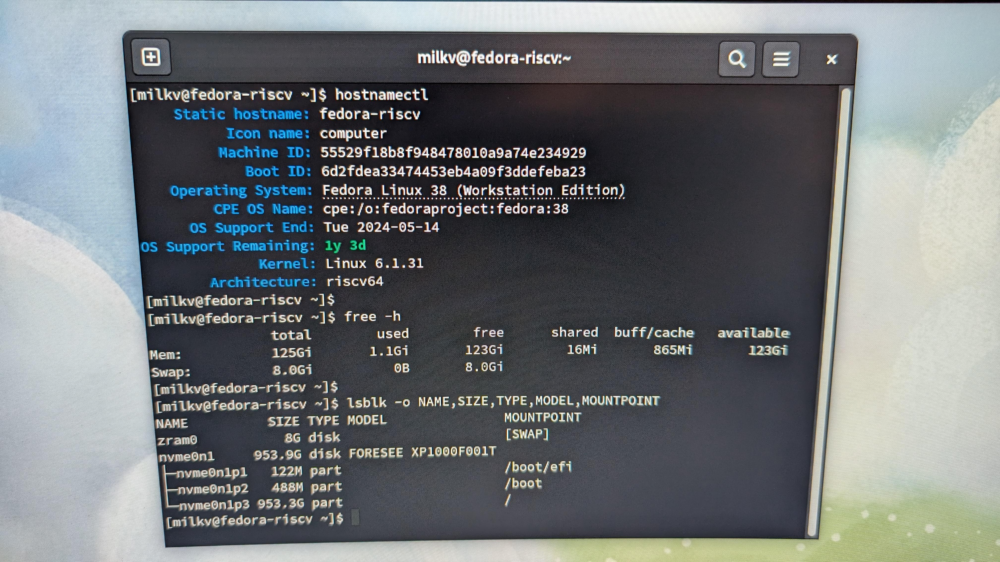
  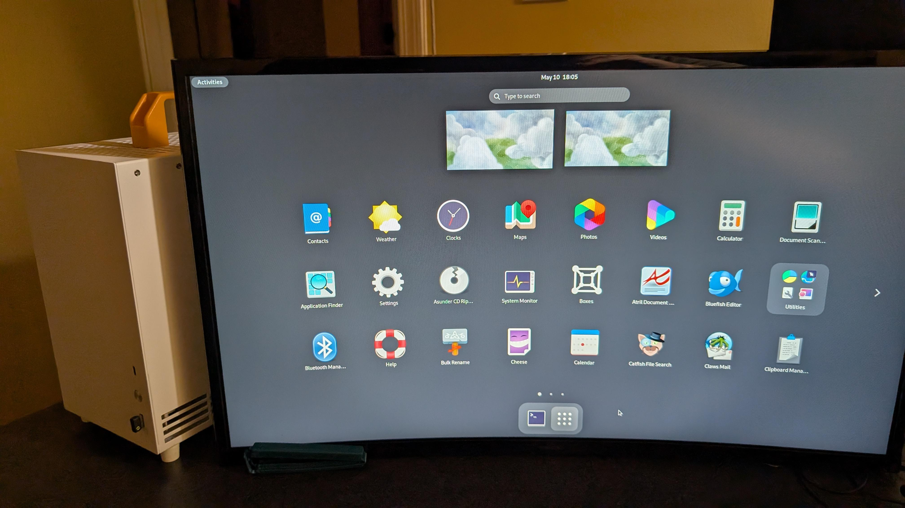

## Condition

Used, but barely. Backed through the Crowd Supply crowdfunding round, delivered January 2024, and hardly used since. No known faults — it booted and ran as expected. The installed OS was **Fedora 38 Workstation**.

## The crowdfunding order

This unit was backed during the original [Crowd Supply](https://www.crowdsupply.com/milk-v/pioneer) campaign. The order confirmation and shipping emails from the campaign are shown below.

  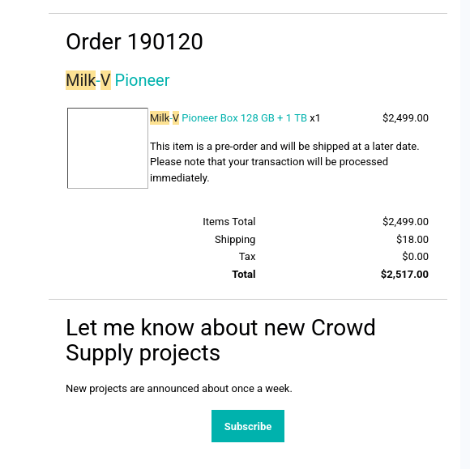
  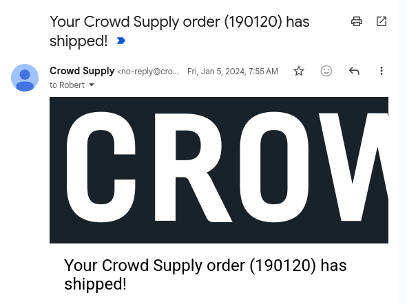
  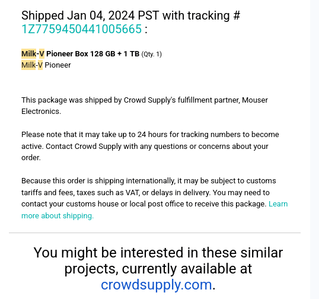

## Sale

Listed at **US$1,300** (≈ C$1,800) on October 29, 2026. Sold for **US$1,000** on November 11, 2026 — 13 days on the market.

- [PayPal G&amp;S](https://www.paypal.com), Interac e-transfer, or cash on pickup
- Vancouver, Canada — shipped domestically or internationally at buyer's cost, or local pickup
- Payment could be made in USD or CAD

These are very rare. Thanks to everyone who expressed interest.

---

*Board documentation and full specifications: [milkv.io/pioneer](https://milkv.io/pioneer).*