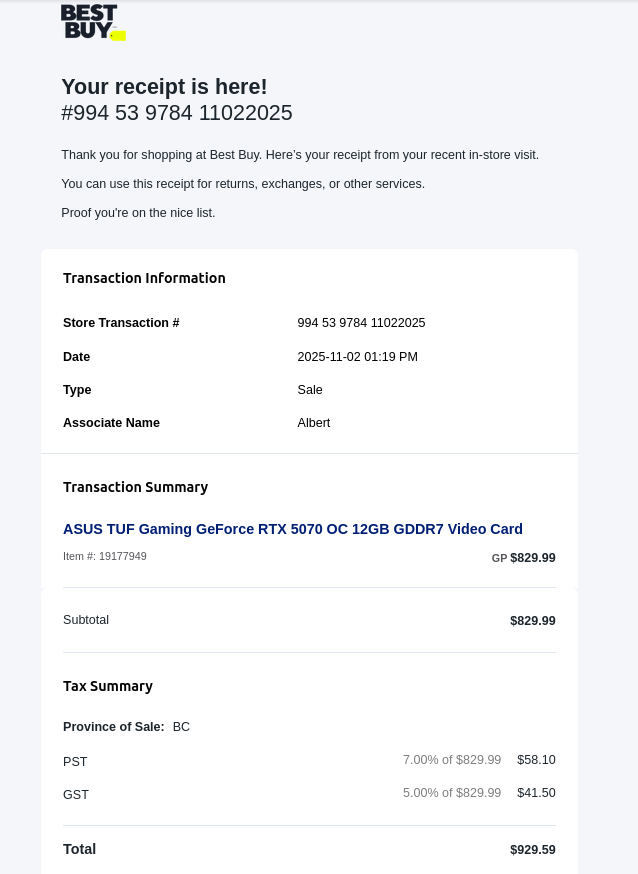
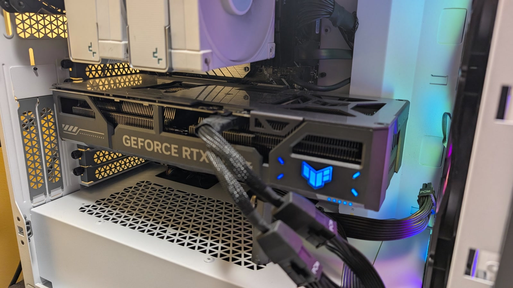
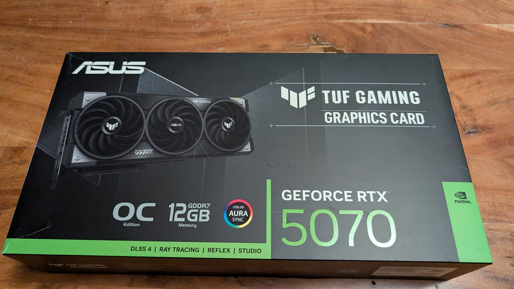
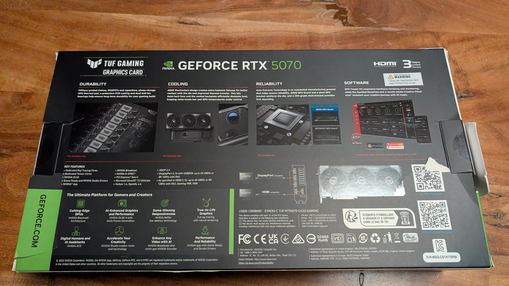
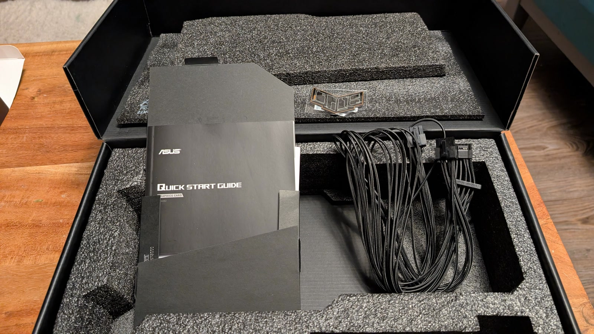
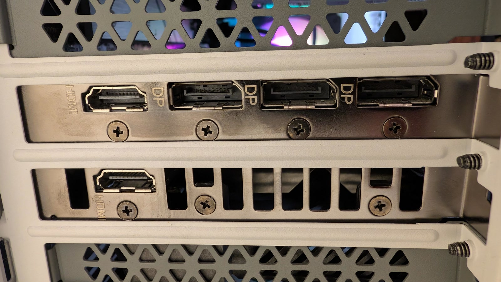

For sale: an **ASUS TUF Gaming GeForce RTX 5070 OC Edition** with **12 GB of GDDR7**. I bought it new in November 2025, and it has been used in a desktop since. It is fully working and comes complete with the original box, cables, documentation, decal and receipt.

This is the 3.125-slot TUF model with the large triple-fan cooler, so check your case clearance before buying. It is a strong 1440p card, and the 12 GB frame buffer is also useful for local AI work.

## Specifications

| Item | Specification |
|---|---|
| GPU | NVIDIA GeForce RTX 5070 |
| Model | ASUS TUF Gaming RTX 5070 OC Edition (TUF-RTX5070-O12G-GAMING) |
| Memory | 12 GB GDDR7, 192-bit, 28 Gbps |
| CUDA cores | 6,144 |
| Bus | PCIe 5.0 x16 |
| Slot width | 3.125-slot |
| Dimensions | 329 × 140 × 62.5 mm |
| Power | 1 × 16-pin; 750 W recommended PSU |
| Outputs | 5 display outputs (3 × DisplayPort 2.1b, 2 × HDMI 2.1b) |
| Features | DLSS 4, ray tracing, 988 AI TOPS, AURA Sync ARGB |

## Purchase, warranty and condition

- Bought new on 2 November 2025 for **CA$829.99** plus tax (CA$929.59 total). Original receipt included.
- One owner, used in a home desktop and actively driving three monitors in daily use. Fully working, no known faults.
- Original box, original power cables/16-pin adapter, quick start guide and TUF decal included.
- **3-year ASUS warranty** as printed on the box, running through November 2028 (subject to ASUS terms).
- Can be inspected and tested in Vancouver by arrangement.

<figure class="receipt">
  
  <figcaption>Best Buy receipt, 2 November 2025: ASUS TUF Gaming GeForce RTX 5070 OC 12GB GDDR7, CA$829.99 plus tax (CA$929.59 total).</figcaption>
</figure>

## Photos and video

  <figure>
    
    <figcaption>The card installed and running in my desktop.</figcaption>
  </figure>
  <figure>
    
    <figcaption>Retail box: ASUS TUF Gaming RTX 5070 OC, 12 GB GDDR7.</figcaption>
  </figure>
  <figure>
    
    <figcaption>Box rear with the specifications and feature summary.</figcaption>
  </figure>
  <figure>
    
    <figcaption>Box contents: quick start guide, 16-pin power adapter and TUF decal.</figcaption>
  </figure>
  <figure>
    
    <figcaption>Display outputs: two HDMI and three DisplayPorts.</figcaption>
  </figure>

<figure class="gpu-video">
  <video controls preload="metadata" poster="/assets/rtx-5070/gpu-video-01-poster.jpg">
    <source src="/assets/rtx-5070/gpu-video-01.mp4" type="video/mp4">
    Your browser does not support the video tag.
  </video>
  <figcaption>A short clip of the card running.</figcaption>
</figure>

## Price and shipping

<strong>US$825</strong> (≈ C$1,165) or nearest offer.

Pickup in Vancouver, BC, or shipping worldwide at the buyer's expense. The card is small enough to ship tracked and insured without difficulty. Payment can be made in USD or CAD.

<small>CAD prices are approximate, converted at US$1 ≈ C$1.41 on 10 November 2026.</small>

Payment by PayPal G&amp;S, Interac e-transfer, or cash on pickup. If you want more photos, the receipt, or a benchmark before buying, [get in touch](/contact/).
