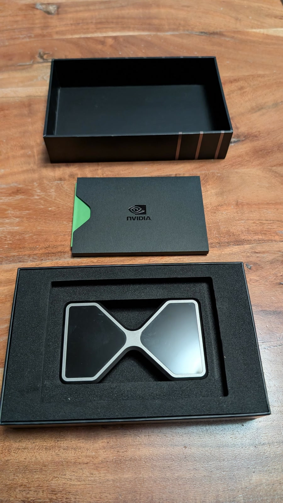
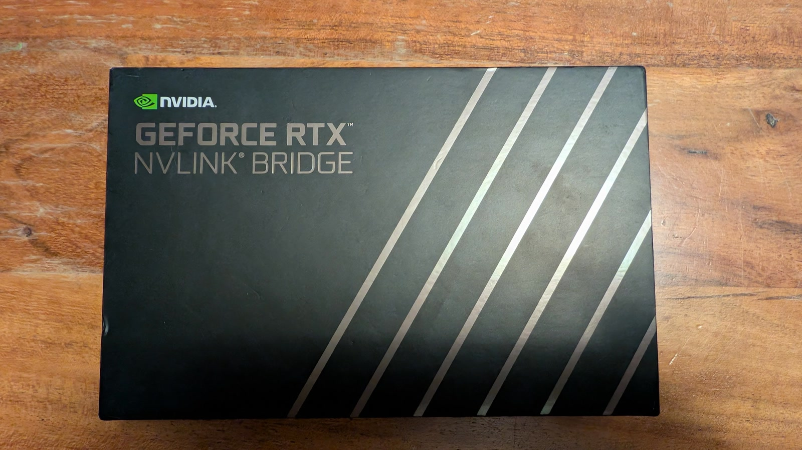
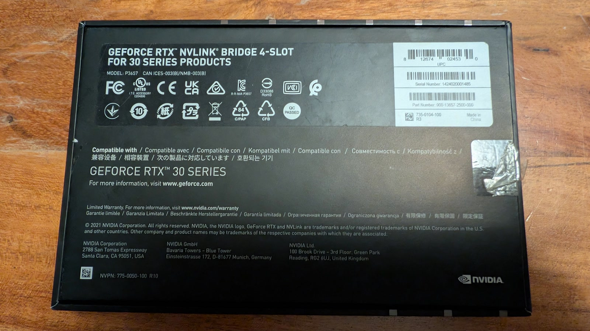
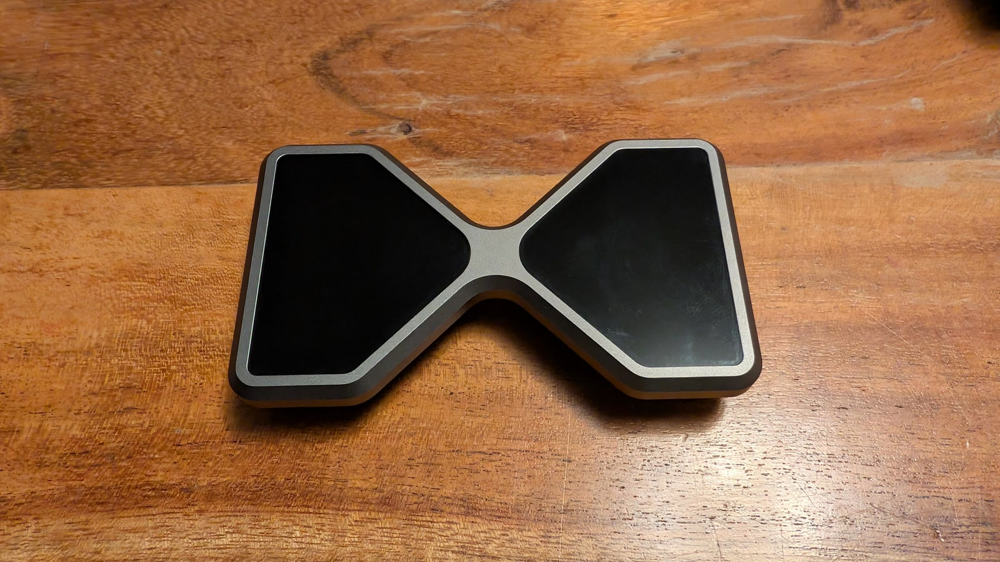
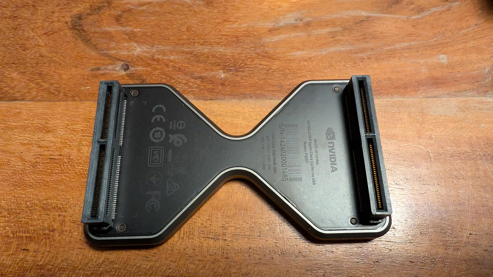
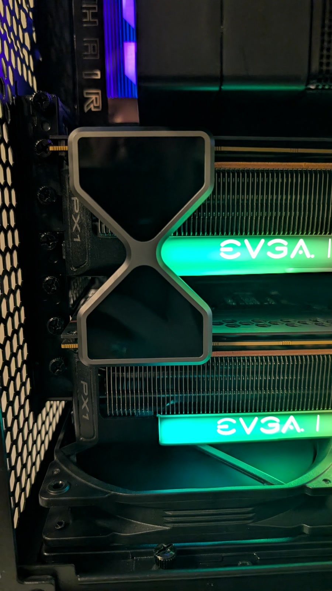

**SOLD with the Shadowfax dual RTX 3090 workstation.** This was a genuine **NVIDIA 4-slot NVLink bridge** for a pair of RTX 3090 or RTX 3090 Ti cards. This was the high-bandwidth bridge — part **P3657**, NVIDIA part number **900-13657-2500-000** — not the shorter 3-slot version.

The 4-slot bridge has become very hard to find, and prices for used examples have climbed with demand for dual-3090 AI builds. This was the bridge from my dual-3090 machine, **Shadowfax**, where it was in daily use — and it came with its **original box and leaflet**.

## What NVLink does for a pair of 3090s

RTX 3090 is the only GeForce card of its generation with NVLink. With the bridge fitted, the two GPUs get a direct high-bandwidth link instead of sending everything over PCIe. That matters for tensor-parallel inference, where the cards have to exchange activations and all-reduce results on every layer.

It does not merge the two 24 GB frame buffers into one 48 GB allocation. Each card still has 24 GB, but the cards can access each other's memory peer-to-peer and move data much faster than over PCIe.

## Specifications

| Item | Specification |
|---|---|
| Type | NVIDIA NVLink High Bandwidth (HB) bridge |
| Spacing | 4-slot |
| NVIDIA part number | 900-13657-2500-000 |
| Model / revision | P3657 |
| Links | 4 per GPU pair |
| Link speed | 14.062 GB/s per link |
| Aggregate | About 56 GB/s per direction, about 112 GB/s bidirectional |
| Topology reported by `nvidia-smi` | NV4 |
| Supported cards | NVIDIA GeForce RTX 3090 and RTX 3090 Ti |

## Fit and compatibility

- Fits **RTX 3090 and RTX 3090 Ti** only. RTX 3080, 3080 Ti and the rest of the 30-series do not support NVLink.
- This is the **4-slot** spacing version. Check the distance between the NVLink fingers on your two cards before buying: a 3-slot bridge is visibly shorter and will not reach across a 4-slot gap.
- Both cards need to be oriented the same way, as usual for an NVLink bridge.
- No drivers or software are required; the bridge is passive. `nvidia-smi topo -m` should report `NV4` once it is fitted and both cards are visible.

## Condition

- Used, genuine NVIDIA part, removed from Shadowfax, my dual-RTX-3090 workstation.
- Proven working in daily use — the video below shows it installed and running in Shadowfax.
- Tested in that machine: `nvidia-smi topo -m` reported `NV4`, and `nvidia-smi nvlink -s` showed all four links active at 14.062 GB/s on each GPU.
- Original NVIDIA box and leaflet included.
- No cracks, no bent or damaged connector fingers. Cosmetic wear is minimal.
- It was removed from Shadowfax and packed with the workstation.

## Photos and video

  <figure>
    
    <figcaption>Original box, leaflet and foam tray.</figcaption>
  </figure>
  <figure>
    
    <figcaption>Box lid: NVIDIA GeForce RTX NVLink Bridge.</figcaption>
  </figure>
  <figure>
    
    <figcaption>Box label confirming P3657 and part 900-13657-2500-000.</figcaption>
  </figure>
  <figure>
    
    <figcaption>The 4-slot bridge, top side.</figcaption>
  </figure>
  <figure>
    
    <figcaption>Connector side, showing the two NVLink fingers.</figcaption>
  </figure>
  <figure>
    
    <figcaption>Previously installed between the two EVGA RTX 3090s in Shadowfax.</figcaption>
  </figure>

<figure class="nvlink-video">
  <video controls preload="metadata" poster="/assets/nvlink/nvlink-video-01-poster.jpg">
    <source src="/assets/nvlink/nvlink-video-01.mp4" type="video/mp4">
    Your browser does not support the video tag.
  </video>
  <figcaption>The bridge running in Shadowfax before removal.</figcaption>
</figure>

## Sale

Sold together with [Shadowfax, the dual RTX 3090 workstation](/2026/11/10/shadowfax-dual-rtx-3090-workstation-for-sale/), for **C$8,500** (≈ US$6,000) on November 13, 2026. The bridge had been listed separately at US$1,000 (≈ C$1,410).

Thanks to everyone who expressed interest.
