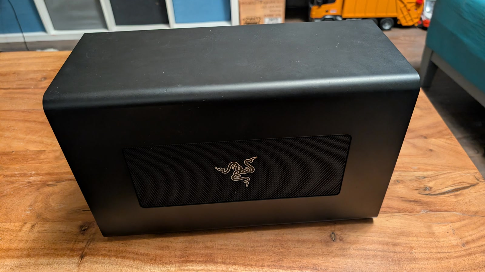
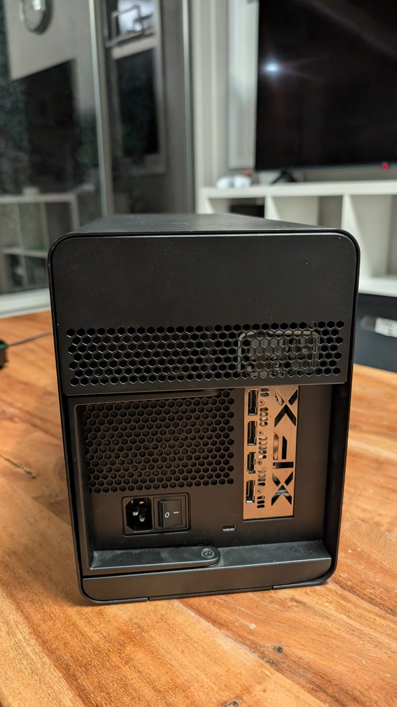
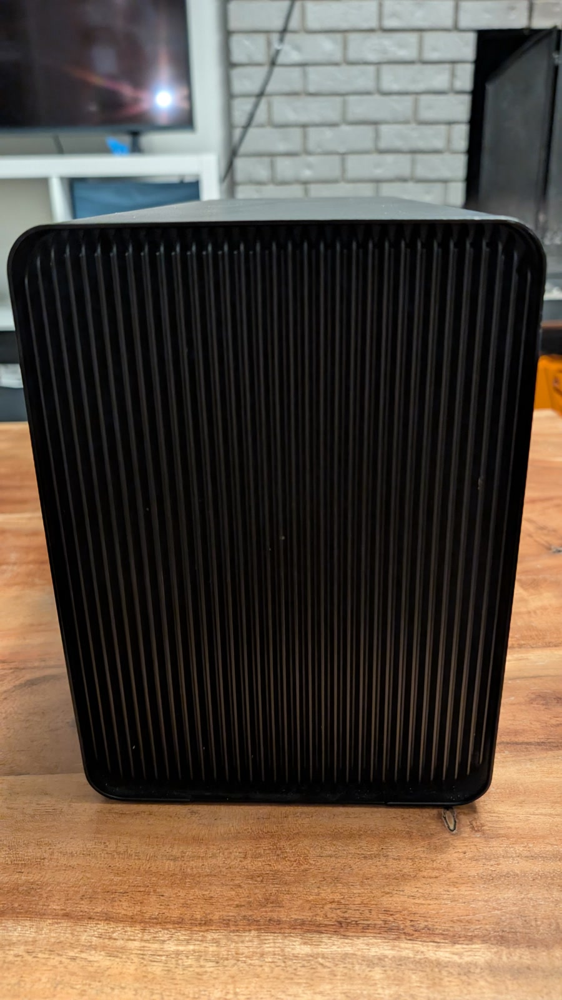
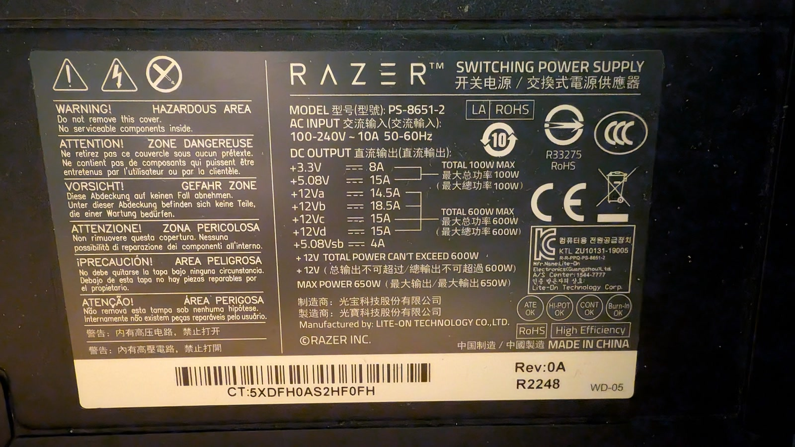
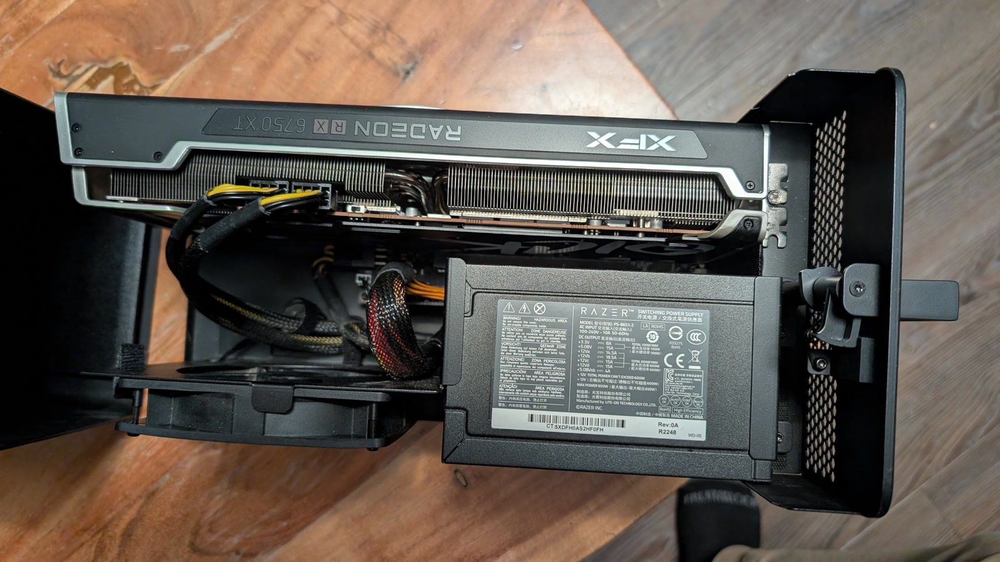

For sale: a **Razer Core X** Thunderbolt 3 external graphics enclosure, model **RC21-0131**. It turns a Thunderbolt 3 laptop or small form-factor desktop into a machine with a desktop-class GPU.

**No graphics card is included** — this listing is for the enclosure alone.

## What it does

The Core X connects over a single Thunderbolt 3 cable, carries display data and up to 100 W of laptop charging, and lets the installed card drive its own monitors directly. The inner tray slides out for card installation, and the internal 650 W ATX supply means there is no external power brick.

## Specifications

| Item | Specification |
|---|---|
| Model | Razer Core X, RC21-0131 (product RC21-01310100) |
| Host connection | Thunderbolt 3 / USB-C, up to 40 Gbps |
| GPU support | One full-length, up to 3-slot-wide PCIe x16 card |
| Internal clearance | Approx. 330 mm long × 160 mm high × 60 mm wide |
| Power supply | 650 W internal ATX, two 8-pin PCIe leads |
| Laptop charging | Up to 100 W over USB-C |
| External dimensions | Approx. 374 × 232 × 168 mm |
| Weight | Approx. 6.46 kg |
| Finish | Aluminium body, black |

Check your card's length, thickness and power connectors against those figures before buying. The 60 mm internal width is the tightest dimension.

## Compatibility

- **Windows 10/11:** works with a Thunderbolt 3 port that supports external graphics.
- **Linux:** Thunderbolt 3 eGPU support is mature.
- **macOS:** the Core X itself is a Mac-compatible enclosure, but macOS only supports specific AMD cards. NVIDIA cards are not supported on current macOS, so plan on Windows or Linux if you fit one.
- Check that your machine's Thunderbolt port actually supports external graphics. Some laptops have Thunderbolt 3/4 for data and displays only.

## Condition

- Used, fully working, with some cosmetic marks from normal use.
- Includes the internal PSU and a Thunderbolt 3 cable.
- **No GPU included.**
- No original retail box is guaranteed, but it will be packed properly for shipping.
- Can be inspected and tested in Vancouver by arrangement.

## Photos

  <figure>
    
    <figcaption>Front and side view.</figcaption>
  </figure>
  <figure>
    
    <figcaption>Rear I/O and power.</figcaption>
  </figure>
  <figure>
    
    <figcaption>Side vents and aluminium body.</figcaption>
  </figure>
  <figure>
    
    <figcaption>650 W internal PSU (Razer PS-8651-2).</figcaption>
  </figure>
  <figure>
    
    <figcaption>Interior with a card fitted for the photo; the graphics card is not included.</figcaption>
  </figure>

## Price and shipping

<strong>US$250</strong> (≈ C$350) or nearest offer.

Pickup in Vancouver, BC, or shipping worldwide at the buyer's expense. The enclosure is about 6.5 kg, so I will quote exact shipping before you commit. Payment can be made in USD or CAD.

<small>CAD prices are approximate, converted at US$1 ≈ C$1.41 on 10 November 2026.</small>

Payment by PayPal G&amp;S, Interac e-transfer, or cash on pickup. If you want more photos or the exact serial number before buying, [get in touch](/contact/).
