

**SOLD for C$8,500 (≈ US$6,000) including the NVLink bridge after 3 days.** I listed **Shadowfax** — the lab's dual RTX 3090 workstation — at US$5,100 (≈ C$7,200) on November 10, 2026. It was a custom AMD desktop with two EVGA RTX 3090 FTW3 Ultra cards, 48 GB of VRAM in total, and enough CPU and memory to feed them. It sold with the NVLink bridge on November 13, 2026.

It had been in daily use serving local models, and it worked. There were no known faults. I preferred to sell it as a complete, tested system rather than part it out.

## Why it is interesting

Two 24 GB RTX 3090s remain one of the most cost-effective ways to get 48 GB of VRAM for local inference. The 9950X3D and 64 GB of DDR5 kept the host responsive while the GPUs were loaded, and the board has enough PCIe and networking for a small lab.

This was not a gaming build with AI bolted on. It was a working inference box: it served **Qwen3.8-27B at EXL3 5 bpw** across both GPUs with a **131,072-token context**, and it also ran **DeepSeek-V4-Flash-REAP** — a 132-expert FP8 mixture-of-experts with 79 GB of local weights — through the [Colibri](https://github.com/bobsummerwill/colibri) runtime.

## Hardware

| Component | Specification |
|---|---|
| Motherboard | ASUS ROG Crosshair X870E Hero, AM5, DDR5, PCIe 5.0 |
| CPU | AMD Ryzen 9 9950X3D — 16 cores / 32 threads, up to 5.7 GHz, 128 MB L3 |
| CPU cooler | DeepCool Assassin IV dual-tower air cooler |
| Memory | 64 GB Kingston Fury Beast DDR5-6000 CL30 (2 × 32 GB) |
| GPUs | 2 × EVGA GeForce RTX 3090 FTW3 Ultra, 24 GB GDDR6X each (48 GB total) |
| GPU interconnect | NVIDIA 4-slot NVLink bridge included |
| Storage | WD_BLACK SN850X 4 TB NVMe |
| PSU | Seasonic PRIME PX-1600 ATX 3, 1600 W 80+ Platinum, fully modular |
| Case | Fractal Design Torrent, high-airflow tower |
| Networking | Aquantia AQC107 10 GbE, Intel I226-V 2.5 GbE, Realtek RTL8126 5 GbE, MediaTek MT7927 Wi-Fi 7, Thunderbolt 3 add-in card |
| Operating system | Ubuntu 24.04.5 LTS, kernel 7.0.0-38-generic |
| Driver / CUDA | NVIDIA 595.99.02, CUDA 13.2 |

## System report

<figure class="shadowfax-media">
  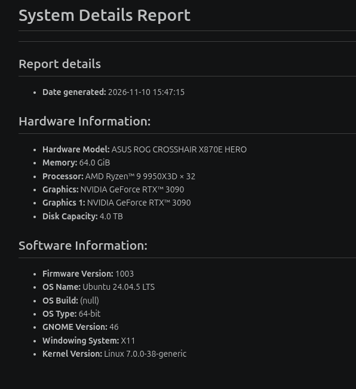
  <figcaption>GNOME system report generated on 10 November 2026, confirming the CPU, memory, GPUs, storage and OS.</figcaption>
</figure>

## Power

The component TDPs add up to about **950 W**:

| Component | TDP |
|---|---:|
| CPU (9950X3D) | 170 W |
| Motherboard | ~50 W |
| Memory | ~10 W |
| GPU 1 (RTX 3090 FTW3 Ultra) | 350 W |
| GPU 2 (RTX 3090 FTW3 Ultra) | 350 W |
| NVLink bridge | ~2 W |
| CPU cooler | ~5 W |
| Case fans | ~15 W |
| **Total (stock)** | **~952 W** |

Those are stock TDP figures. Both cards are configured with raised board power limits — **500 W** and **450 W** — so at full tilt the GPUs alone can draw 950 W and the whole system about **1,200 W**. The 1600 W 80+ Platinum PSU covers that with plenty of headroom.

<figure class="shadowfax-media shadowfax-media--portrait">
  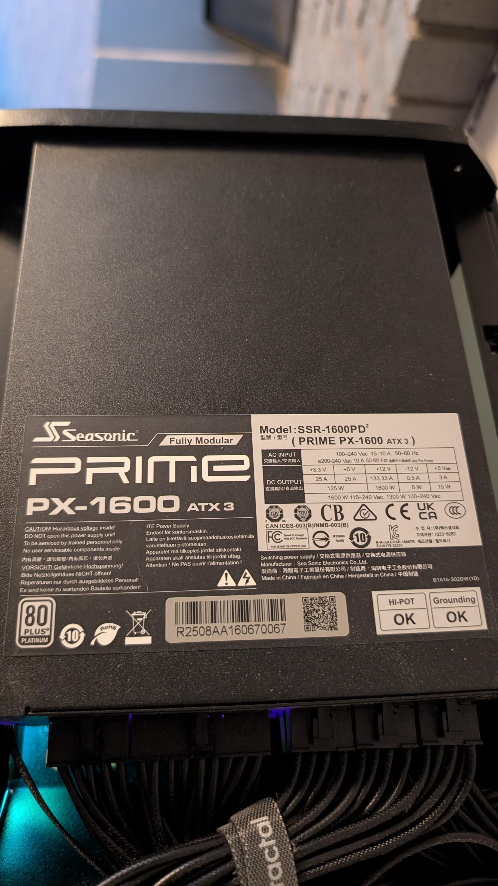
  <figcaption>Seasonic PRIME PX-1600 ATX 3 (SSR-1600PD²), 1600 W 80+ Platinum, fully modular.</figcaption>
</figure>

The two cards are NVLink-capable, and the EVGA 4-slot bridge was included in the sale.

## What it ran

- **Tabby with ExLlamaV3 1.6.3** served Qwen3.8-27B at EXL3 5 bpw, tensor-parallel across both GPUs with a 22/22 GB split.
- Speculative decoding with **MTP and 5 draft tokens**, maximum batch size 4.
- **131,072-token context** per request with a 262,144-token FP16 KV cache.
- **DeepSeek-V4-Flash-REAP** through Colibri: 132 experts, 6 active, 43 layers, 1M-token maximum context, 79 GB of local weights.
- OpenAI-compatible endpoint on the tailnet, with the model backend bound to `127.0.0.1:18083`.

You did not need to run it the same way. It was a standard Ubuntu box with two 3090s, so it would run llama.cpp, vLLM, ExLlama, PyTorch or whatever else you preferred.

## Photos and video

The case panels and filters are shown removed in some photos so you can see the layout, cable routing and condition. Click any photo to open the full-size version.

  <figure>
    <a href="/assets/shadowfax/hero.jpg" target="_blank" rel="noopener">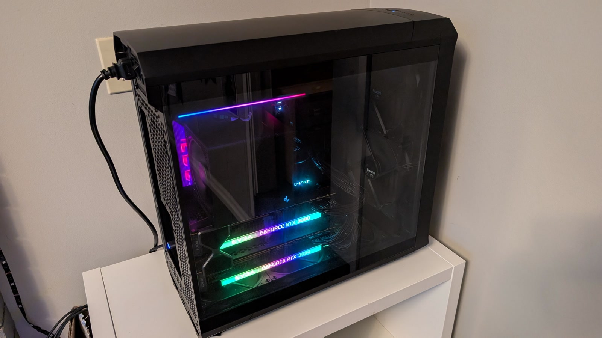</a>
    <figcaption>The machine running with the glass side panel fitted.</figcaption>
  </figure>
  <figure>
    <a href="/assets/shadowfax/photo-01.jpg" target="_blank" rel="noopener">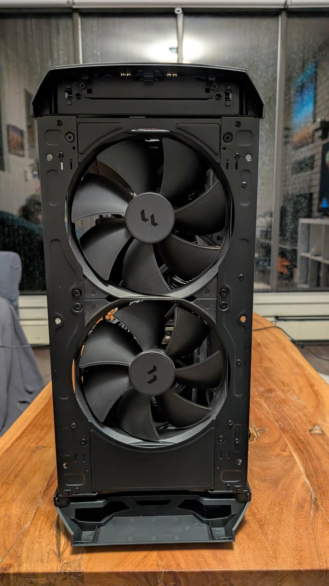</a>
    <figcaption>Front with the panel removed, showing the two 180 mm intake fans.</figcaption>
  </figure>
  <figure>
    <a href="/assets/shadowfax/photo-02.jpg" target="_blank" rel="noopener">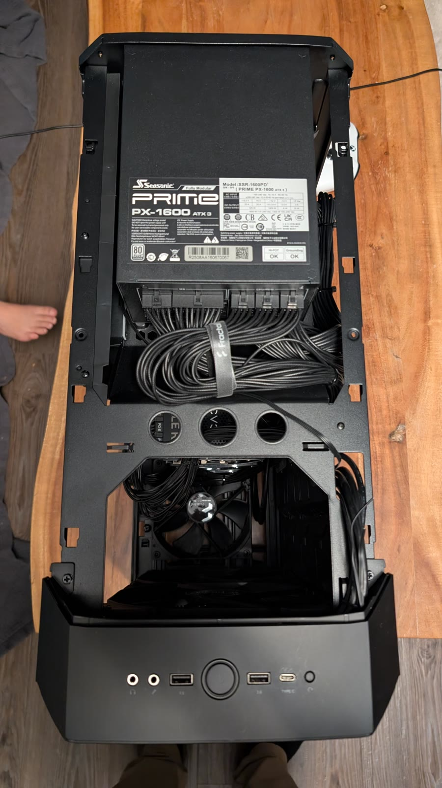</a>
    <figcaption>Seasonic PRIME PX-1600 ATX 3 power supply.</figcaption>
  </figure>
  <figure>
    <a href="/assets/shadowfax/photo-03.jpg" target="_blank" rel="noopener">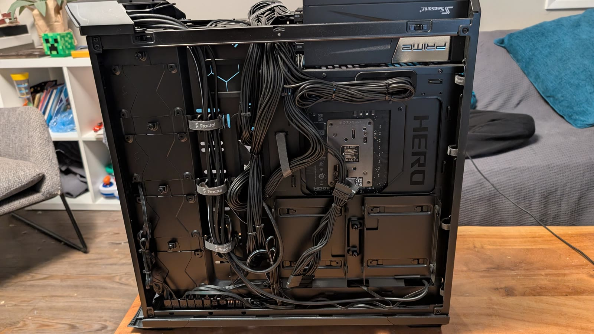</a>
    <figcaption>Rear cable-management side.</figcaption>
  </figure>
  <figure>
    <a href="/assets/shadowfax/photo-04.jpg" target="_blank" rel="noopener">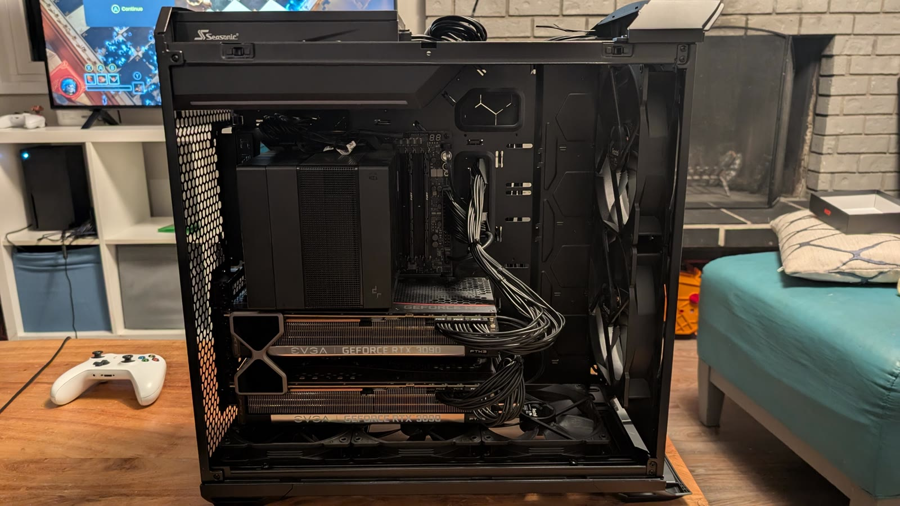</a>
    <figcaption>Interior: two EVGA RTX 3090 FTW3 Ultras and the DeepCool Assassin IV cooler.</figcaption>
  </figure>
  <figure>
    <a href="/assets/shadowfax/photo-05.jpg" target="_blank" rel="noopener">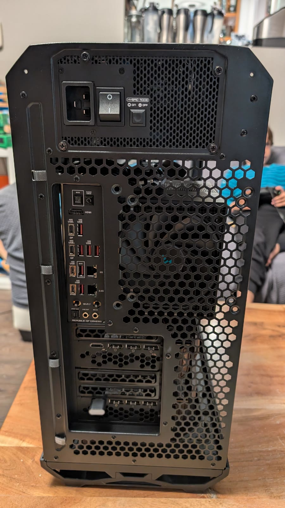</a>
    <figcaption>Rear I/O and power switch.</figcaption>
  </figure>
  <figure>
    <a href="/assets/shadowfax/photo-06.jpg" target="_blank" rel="noopener">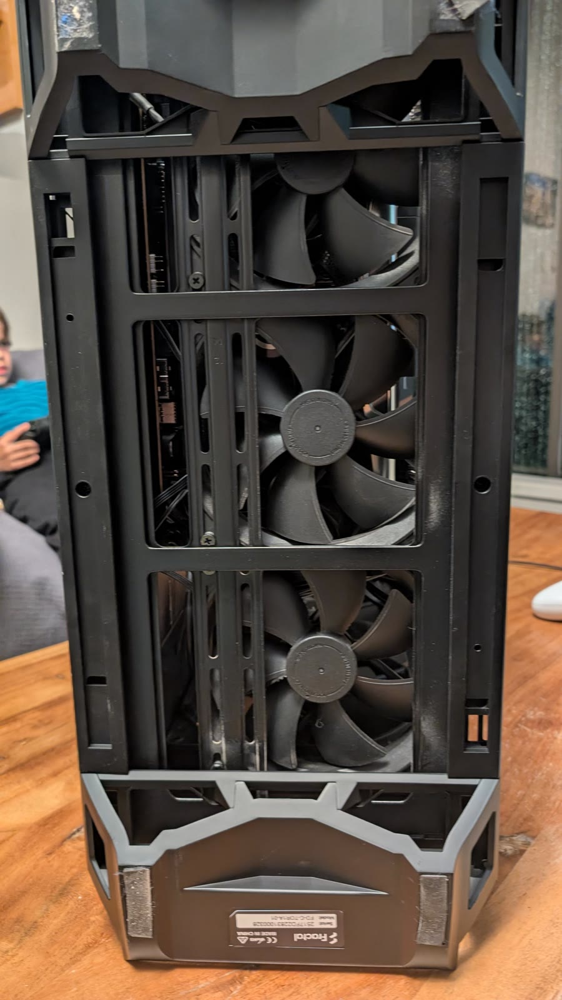</a>
    <figcaption>Close-up of the front intake fans.</figcaption>
  </figure>
  <figure>
    <a href="/assets/shadowfax/photo-07.jpg" target="_blank" rel="noopener">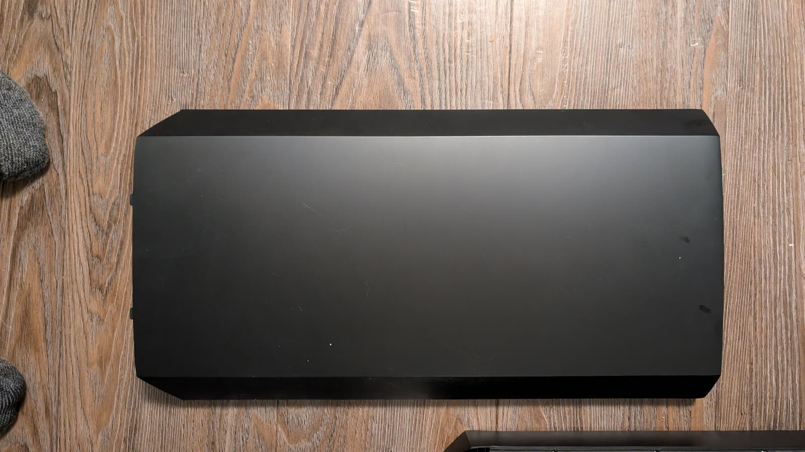</a>
    <figcaption>Exterior side panel.</figcaption>
  </figure>
  <figure>
    <a href="/assets/shadowfax/photo-08.jpg" target="_blank" rel="noopener">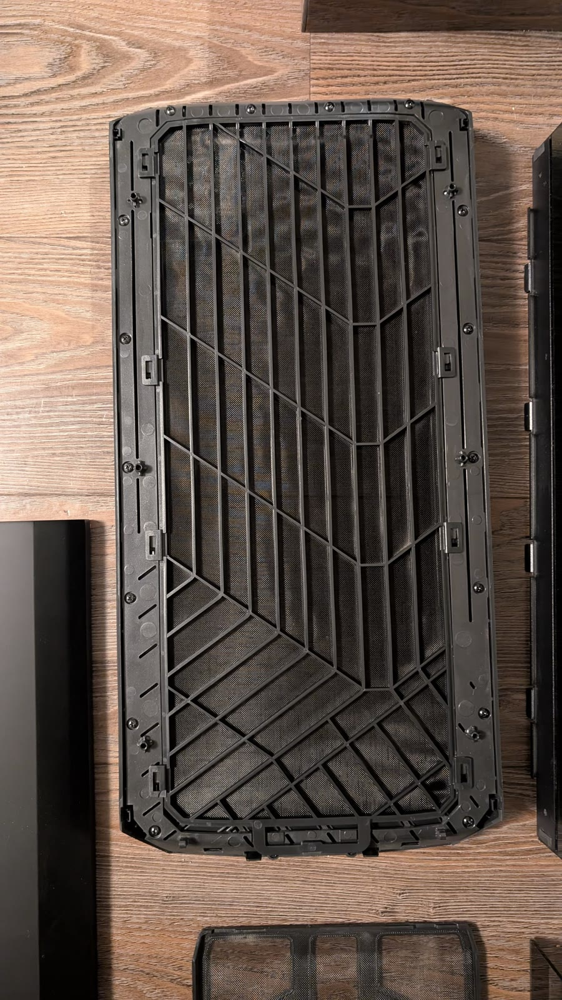</a>
    <figcaption>Front mesh filter.</figcaption>
  </figure>
  <figure>
    <a href="/assets/shadowfax/photo-09.jpg" target="_blank" rel="noopener">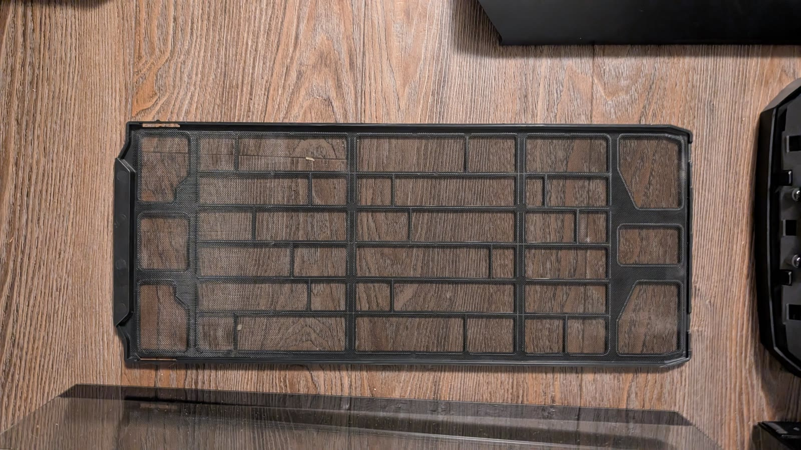</a>
    <figcaption>Top mesh filter.</figcaption>
  </figure>
  <figure>
    <a href="/assets/shadowfax/photo-10.jpg" target="_blank" rel="noopener">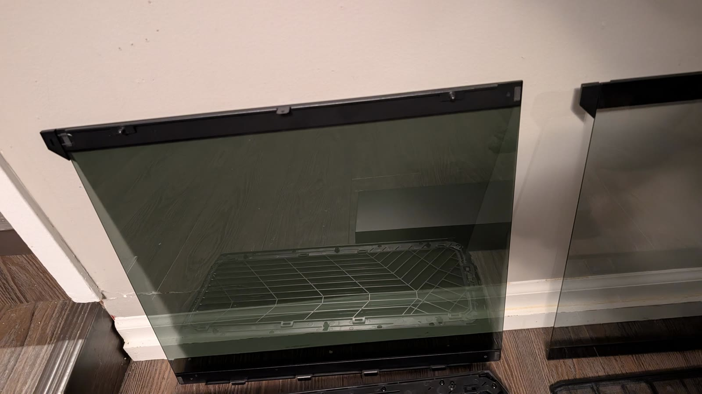</a>
    <figcaption>Tempered-glass side panel.</figcaption>
  </figure>
  <figure>
    <a href="/assets/shadowfax/photo-11.jpg" target="_blank" rel="noopener">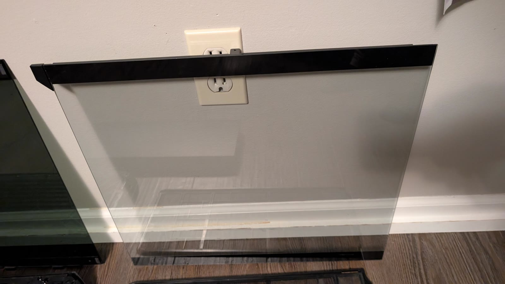</a>
    <figcaption>Tempered-glass side panel, alternate view.</figcaption>
  </figure>

  <figure>
    <video controls preload="metadata" poster="/assets/shadowfax/video-01-poster.jpg">
      <source src="/assets/shadowfax/video-01.mp4" type="video/mp4">
      Your browser does not support the video tag.
    </video>
    <figcaption>Walkaround of the machine running.</figcaption>
  </figure>
  <figure>
    <video controls preload="metadata" poster="/assets/shadowfax/video-02-poster.jpg">
      <source src="/assets/shadowfax/video-02.mp4" type="video/mp4">
      Your browser does not support the video tag.
    </video>
    <figcaption>Close-up of the running system.</figcaption>
  </figure>

## Condition and what is included

All of the components in the machine were bought new in November 2025, with the exception of the two GPUs, which were bought second-hand.

- Complete desktop: motherboard, 9950X3D, 64 GB DDR5, both RTX 3090s, 4 TB NVMe, power supply, case, CPU cooler and the installed networking cards.
- Ubuntu 24.04.5 was installed, and the existing AI stack was left in place at the buyer's request.
- No monitor, keyboard or mouse was included.
- The machine had been in daily use and could be inspected and tested in Vancouver by arrangement.

## Sale

Listed at **US$5,100** (≈ C$7,200) on November 10, 2026. Sold with the EVGA 4-slot NVLink bridge for **C$8,500** (≈ US$6,000) on November 13, 2026 — 3 days on the market.

- Pickup in Vancouver, BC, or shipping at the buyer's expense
- Payment by PayPal G&amp;S, Interac e-transfer, or cash on pickup

Thanks to everyone who expressed interest.

---

*Full background and specifications: [AI Home Lab](/ai-home-lab/).*
