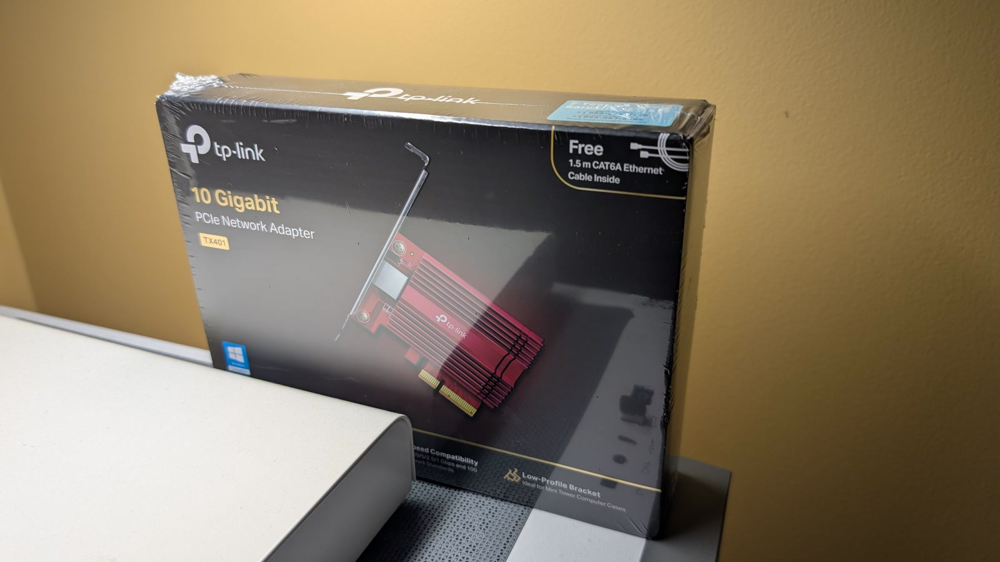

<strong>RETURNED — no longer for sale.</strong> This card has been returned and is no longer available. The specifications and photos below are retained for reference.

This listing was for a **TP-Link TX401** 10 Gigabit PCI Express network adapter, brand new and still sealed in its shrink wrap. It was never opened or installed.

This is a simple way to add a 10 GbE port to a desktop, NAS or home-lab machine without replacing the motherboard. The TX401 uses the Marvell/Aquantia **AQC107** controller — the same class of 10GBASE-T chip found in many pricier cards — and it is well supported on Windows and Linux.

## Specifications

| Item | Specification |
|---|---|
| Model | TP-Link TX401 |
| Interface | PCI Express 3.0 x4 (fits x4, x8 or x16 slots) |
| Port | 1 × RJ45 10GBASE-T |
| Speeds | 10 Gbps, 5 Gbps, 2.5 Gbps, 1 Gbps, 100 Mbps, auto-negotiating |
| Controller | Marvell/Aquantia AQtion AQC107 |
| Standards | IEEE 802.3, 802.3u, 802.3ab, 802.3bz, 802.3an, 802.3az, 802.3x |
| Features | QoS, IEEE 802.3x flow control, link/activity LEDs |
| Brackets | Full-height and low-profile brackets included |
| Dimensions | 120.8 × 98.2 × 21.5 mm |
| Operating systems | Windows 11/10/8.1/8/7, Windows Server 2019/2016/2012 R2, Linux |

## What's in the box

- TP-Link TX401 adapter
- Full-height and low-profile brackets
- 1.5 m CAT6A Ethernet cable
- Quick installation guide and resource CD

The CAT6A cable matters: a standard CAT5e/CAT6 cable will not reliably carry 10 Gbps over any distance, so having the right cable in the box saves another purchase.

## Condition

- **Brand new and unopened** — the retail box is still sealed in shrink wrap.
- Never installed or used.
- The box has been stored indoors; no damage to the card or packaging.
- Includes the manufacturer's **2-year warranty**, as printed on the box.

<figure class="tx401-media">
  
  <figcaption>The retail box, still sealed in shrink wrap.</figcaption>
</figure>

## Status

Listed at **US$55** (≈ C$78) on November 10, 2026. Returned before sale — no longer available.

Thanks to everyone who expressed interest.
