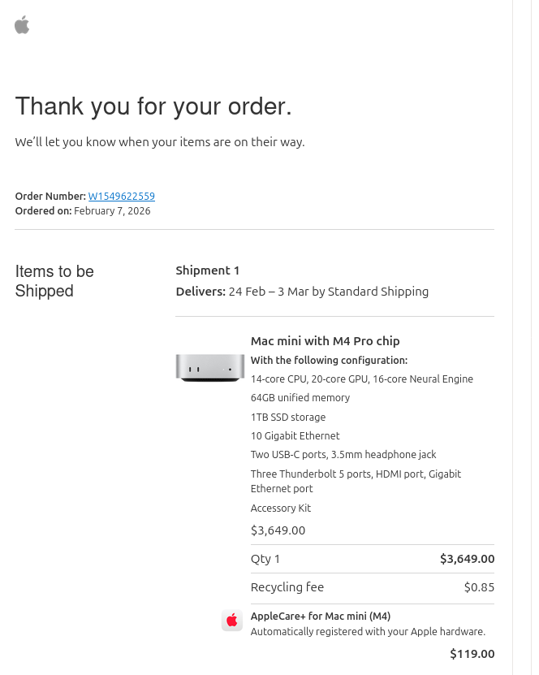
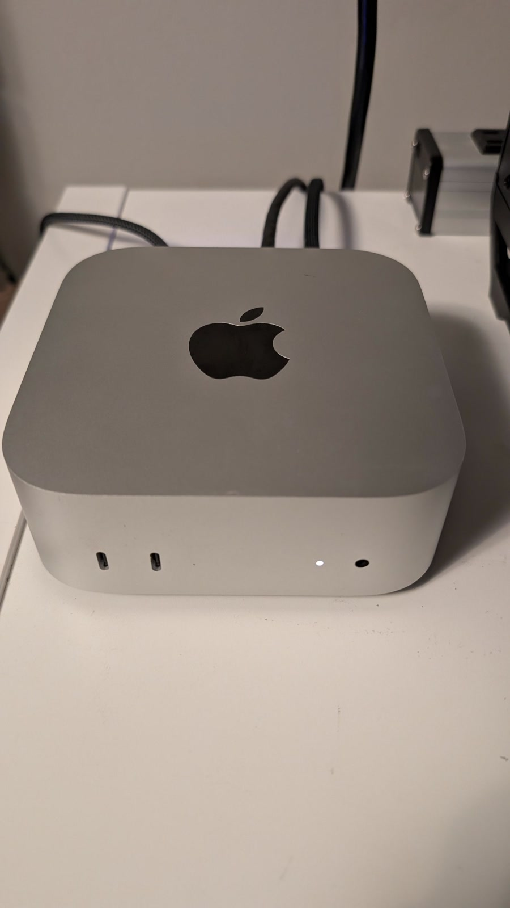
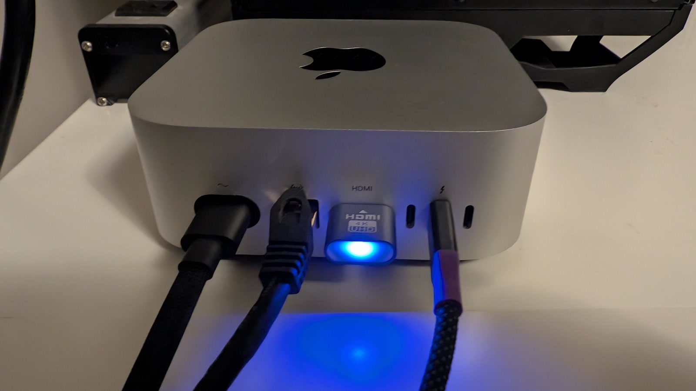
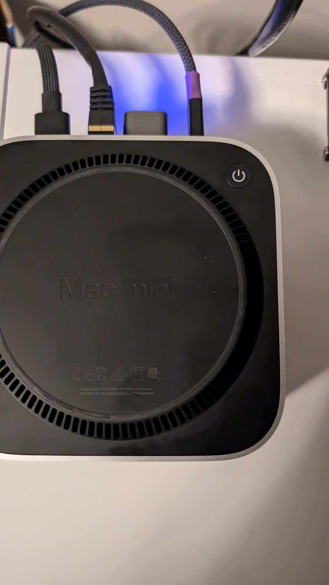

I have some new purchases planned for the [AI home lab](/ai-home-lab/), so **Zebra** — the lab's always-on Mac mini — is for sale. It is an M4 Pro with the maximum 64 GB of unified memory, a 1 TB SSD and 10 Gigabit Ethernet, bought new from Apple in February 2026 and still covered by AppleCare+ until 2 March 2029.

It has been running as a 24/7 local model server. It is quiet, sips power, and is still one of the nicest small machines for local inference on Apple silicon. The 64 GB of memory and 10 GbE are both build-to-order options — 64 GB is the maximum Apple offered in the M4 Pro mini, and 10 GbE was a paid upgrade.

## Why it is interesting

The 64 GB of unified memory is the point. The GPU can address the whole pool, so this machine comfortably runs models that would not fit on a typical 8 GB or 16 GB graphics card. It currently serves **Gemma-4-31B-it Q4_K_M** around the clock with a **131,072-token context**, and it can also join a larger machine as an RPC worker when a model needs more memory than either host has alone.

It is also a very good general-purpose Mac: fast CPU, three Thunderbolt 5 ports, 10 GbE, and very little fan noise.

## Hardware

| Component | Specification |
|---|---|
| Machine | Mac mini (Mac16,11), silver |
| Chip | Apple M4 Pro — 14-core CPU (10 performance + 4 efficiency), 20-core GPU, 16-core Neural Engine |
| Memory | 64 GB unified, 273 GB/s memory bandwidth |
| Storage | 1 TB Apple SSD (AP1024Z, 994.7 GB) |
| Networking | 10 Gigabit Ethernet (10Gbase-T), Wi-Fi 6E (802.11ax), Bluetooth 5.3 |
| Front ports | 2 × USB-C (USB 3), 3.5 mm headphone jack |
| Rear ports | 3 × Thunderbolt 5 (up to 120 Gb/s), HDMI, 10 GbE, power |
| Operating system | macOS 27.0.1 (build 26A434) |
| Dimensions | 5.0 × 5.0 × 2.0 in (127 × 127 × 50 mm) |
| Weight | 1.6 lb (0.73 kg) |

## Purchase and warranty

- Bought new from Apple on 7 February 2026; single owner.
- Original configuration: M4 Pro 14-core CPU / 20-core GPU / 16-core Neural Engine, 64 GB unified memory, 1 TB SSD and 10 Gigabit Ethernet.
- Original Apple price: **CA$3,649**, plus **CA$119** for AppleCare+.
- AppleCare+ for Mac mini (M4) is active until **2 March 2029**. Full details, including the agreement number and proof of coverage, will be made available on sale; I can help transfer the plan to the buyer.

<figure class="mac-mini-receipt">
  
  <figcaption>Apple order receipt, 7 February 2026: Mac mini M4 Pro 14-core/20-core, 64 GB unified memory, 1 TB SSD and 10 Gigabit Ethernet — CA$3,649 plus CA$119 for AppleCare+.</figcaption>
</figure>

## What it runs today

- **llama.cpp 0.6.0-dev** (build 132, Metal) serving **Gemma-4-31B-it Q4_K_M** (17 GB) 24/7.
- 999 GPU layers, flash attention, batch 1024 / ubatch 512, **131,072-token context**, alias `gemma-4-31b` on port `18080`.
- Managed by a LaunchAgent so it comes back after a reboot.
- The local model cache also carries Qwen3.8-27B and Qwen3-30B-A3B Q4_K_M.
- Can act as an RPC worker alongside another llama.cpp host for larger models.

The model cache will be cleared as part of the wipe, so treat the software stack as a demonstration rather than part of the sale.

## Photos

  <figure>
    
    <figcaption>Mac mini powered on.</figcaption>
  </figure>
  <figure>
    
    <figcaption>Rear ports, with the HDMI dummy plug fitted.</figcaption>
  </figure>
  <figure>
    
    <figcaption>Underside, showing the power button and regulatory markings.</figcaption>
  </figure>

## Headless GUI access

An HDMI dummy plug is included if you want it. With the plug fitted, macOS keeps a virtual display active while the Mac mini runs headless, so you can connect to the full desktop over VNC rather than being limited to SSH.

## Condition and what is included

- Single owner, bought new in February 2026. Fully working, no known faults; it has been running continuously as a lab server.
- Sold erased and signed out of iCloud, with macOS reinstalled and ready for setup.
- Original Accessory Kit and power cable included.
- Can be inspected and tested in Vancouver by arrangement.

## Price and shipping

<strong>US$2,500</strong> (≈ C$3,500) or nearest offer. Includes the remaining AppleCare+ coverage until 2 March 2029.

Pickup in Vancouver, BC, or shipping worldwide at the buyer's expense. The Mac mini is small and light, so international shipping is straightforward. Payment can be made in USD or CAD.

<small>CAD price is approximate, converted at US$1 ≈ C$1.41 on 10 November 2026.</small>

Payment by PayPal G&amp;S, Interac e-transfer, or cash on pickup. If you want more photos, a benchmark, or the exact serial number before buying, [get in touch](/contact/).

---

*Full background and specifications: [AI Home Lab](/ai-home-lab/).*
