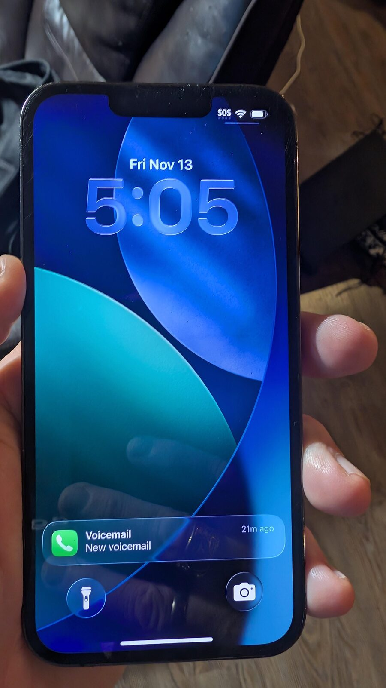
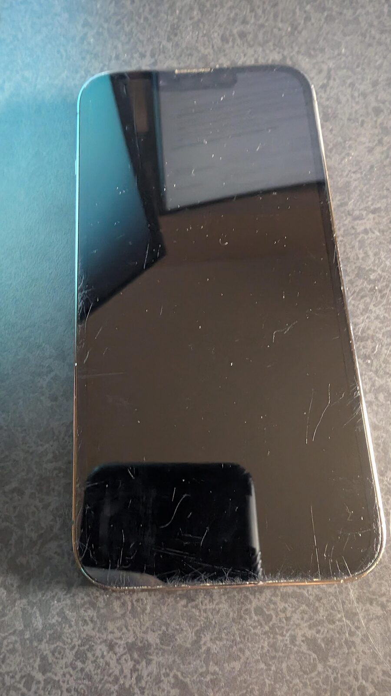
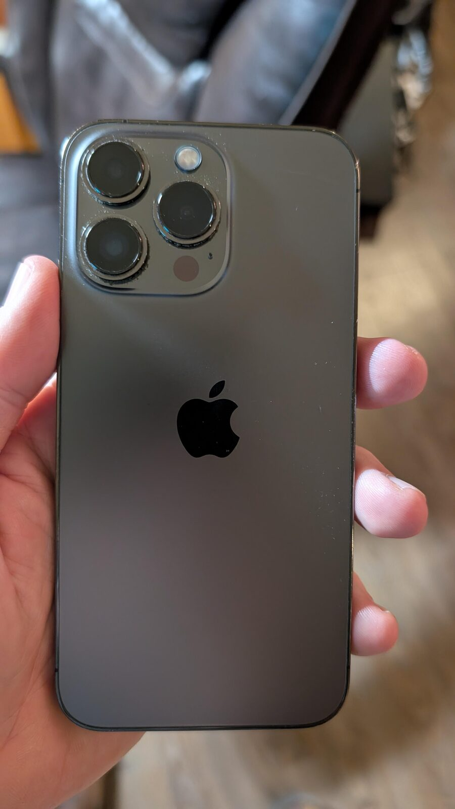
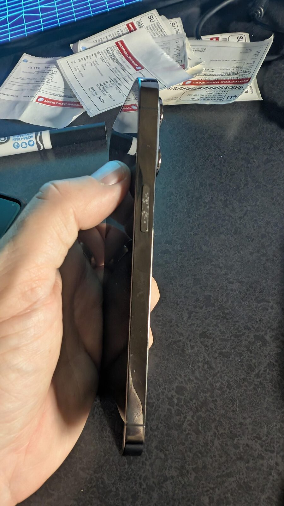
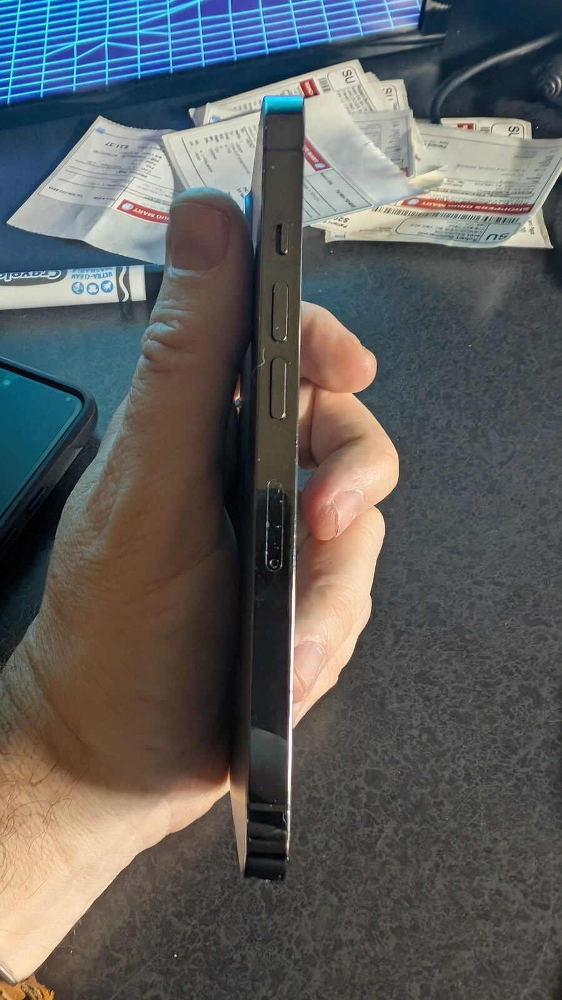
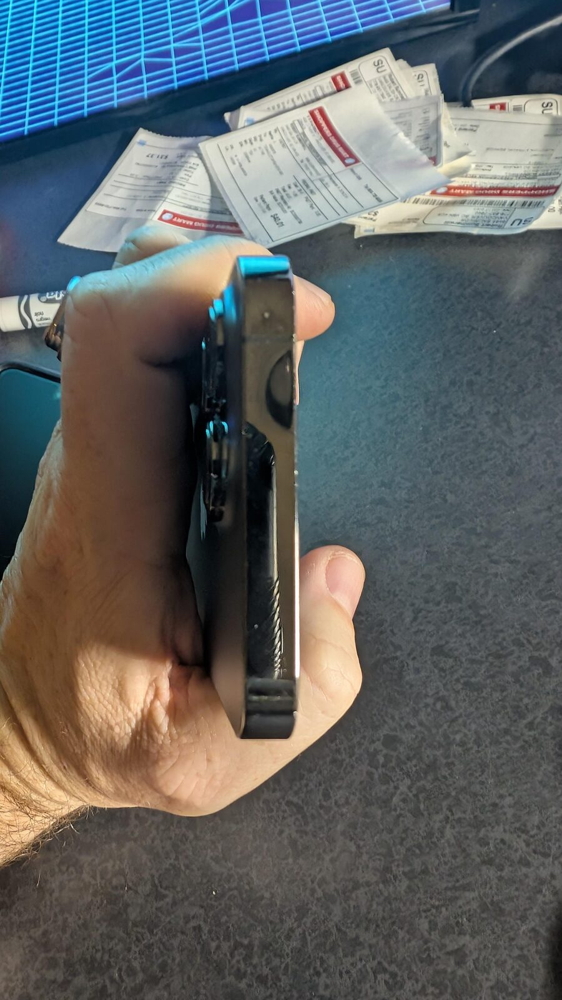
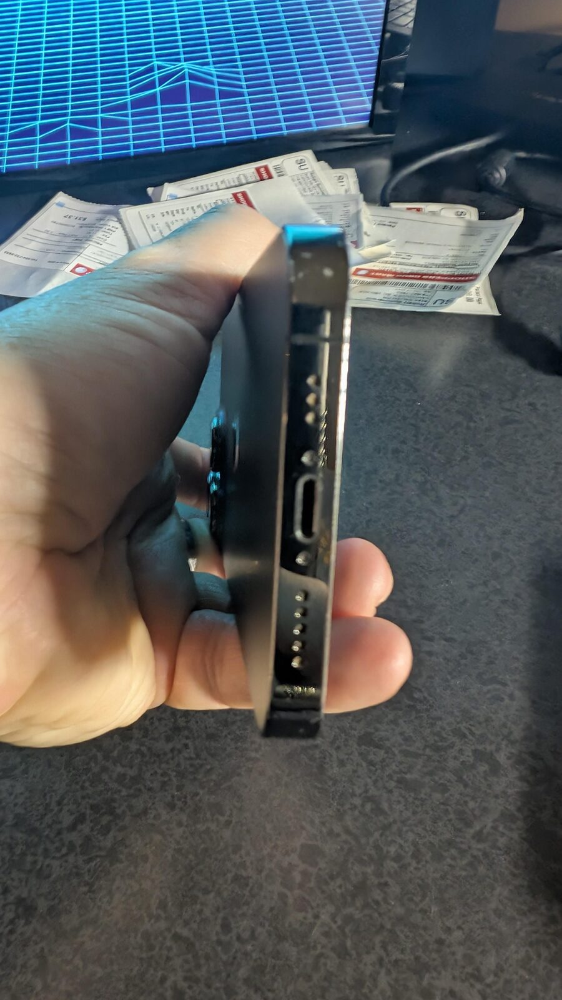
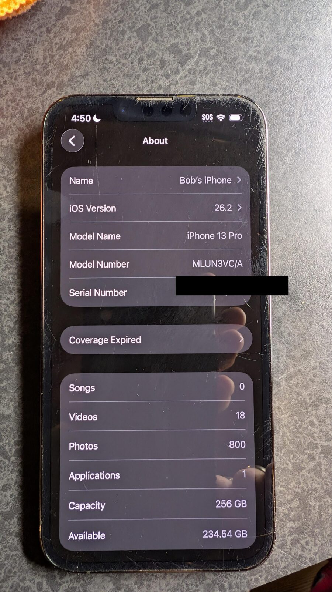

<strong>C$400 — local sale, Vancouver pickup only.</strong>

Unlocked iPhone 13 Pro 256 GB in Graphite. 84% battery health, fully functional, clean edges and back; the screen has light surface scuffs but no cracks. Phone only; factory reset and iCloud activation lock removed on purchase.

For sale: an unlocked **iPhone 13 Pro 256 GB in Graphite**. It has been used as a daily phone but is now surplus to requirements. Everything works, there is no water damage, and the edges and back are clean. The screen has light surface scuffs — visible mainly at an angle — but no cracks.

It will be **factory reset** and **signed out of iCloud / activation lock removed** on purchase.

## Why it is interesting

The 13 Pro is still a very capable phone: a 6.1-inch Super Retina XDR OLED display with **ProMotion 120 Hz**, the A15 Bionic chip, and the triple 12 MP camera system with LiDAR. This one has **256 GB** of storage and is running **iOS 26.2**, so it still receives current software.

It is also **carrier unlocked** — the phone reports **“No SIM restrictions.”**

## Hardware

| Component | Specification |
|---|---|
| Model | iPhone 13 Pro (`MLUN3VC/A`, Canadian model) |
| Storage | **256 GB** (234.54 GB available) |
| Colour | **Graphite** |
| Display | 6.1-inch Super Retina XDR OLED, 120 Hz ProMotion |
| Chip | Apple A15 Bionic |
| Rear cameras | 12 MP wide, 12 MP ultra-wide, 12 MP 3× telephoto; LiDAR scanner |
| Front camera | 12 MP |
| Battery | **84% maximum capacity** |
| Operating system | iOS 26.2 |
| SIM | Nano-SIM + eSIM; **no SIM restrictions** |
| Port | Lightning |
| Warranty | Out of warranty; original purchase receipt available |

## Condition

- **Screen:** light surface scuffs, no cracks; the display and touch work normally.
- **Edges and back:** clean; no cracks or dents.
- **Function:** everything works; no known faults.
- **Water damage:** none.
- **Battery:** 84% maximum capacity.
- **Warranty:** coverage expired. The original purchase receipt is available.

## What is included

- iPhone 13 Pro only.
- **No box, cable, charger, case or screen protector.**
- Factory reset and iCloud activation lock removed on purchase.
- Original purchase receipt available.

## Price and pickup

<strong>C$400</strong>, local sale only. Pickup in Vancouver, BC.

Payment by PayPal G&amp;S, Interac e-transfer, or cash on pickup. Vancouver pickup only; no shipping.

If you want to see it working or check anything before buying, [get in touch](/contact/).

## Photos

  <figure>
    
    <figcaption>Front, screen on.</figcaption>
  </figure>
  <figure>
    
    <figcaption>Front, screen off — light surface scuffs, no cracks.</figcaption>
  </figure>
  <figure>
    
    <figcaption>Graphite back — clean, no cracks.</figcaption>
  </figure>
  <figure>
    
    <figcaption>Left edge — mute switch.</figcaption>
  </figure>
  <figure>
    
    <figcaption>Right edge — volume buttons and SIM tray.</figcaption>
  </figure>
  <figure>
    
    <figcaption>Top edge and camera bump.</figcaption>
  </figure>
  <figure>
    
    <figcaption>Bottom edge — Lightning port and speaker.</figcaption>
  </figure>
  <figure>
    
    <figcaption>About screen — 256 GB, iOS 26.2, coverage expired. Serial number redacted.</figcaption>
  </figure>

