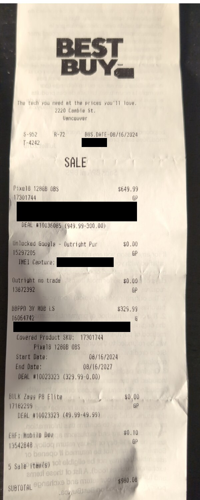
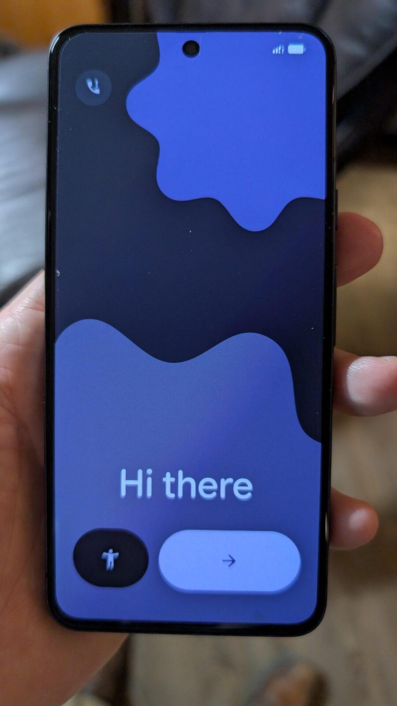
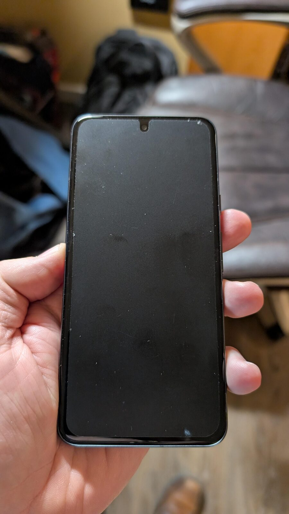
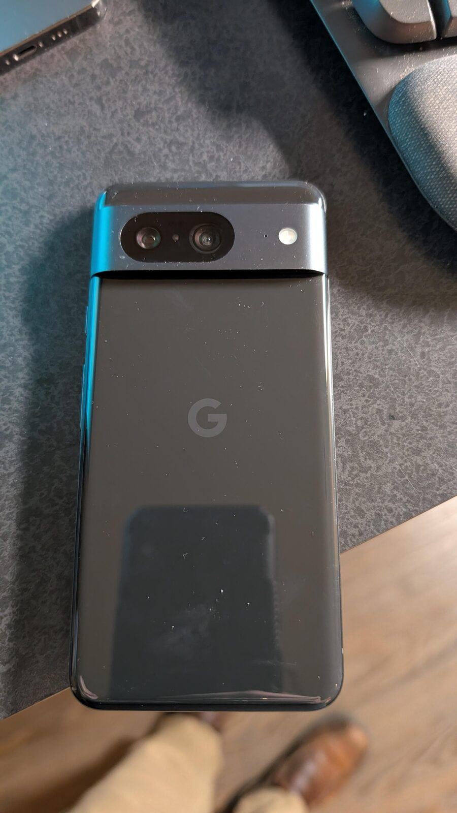
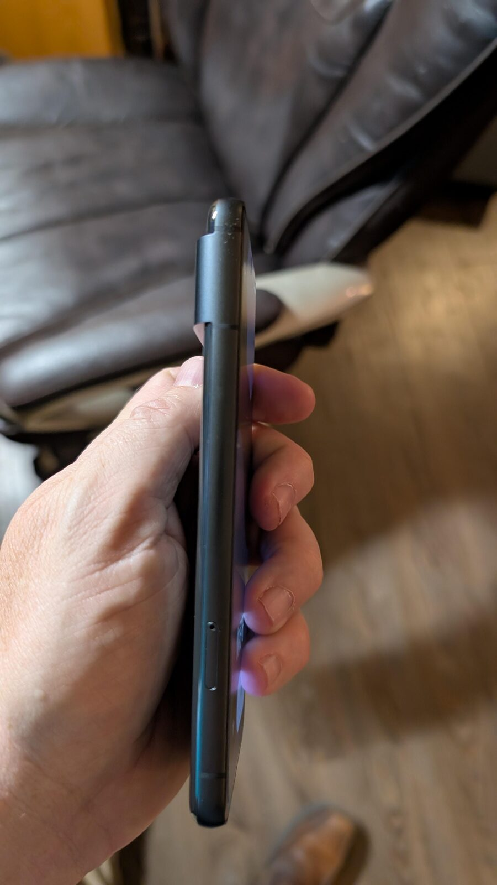
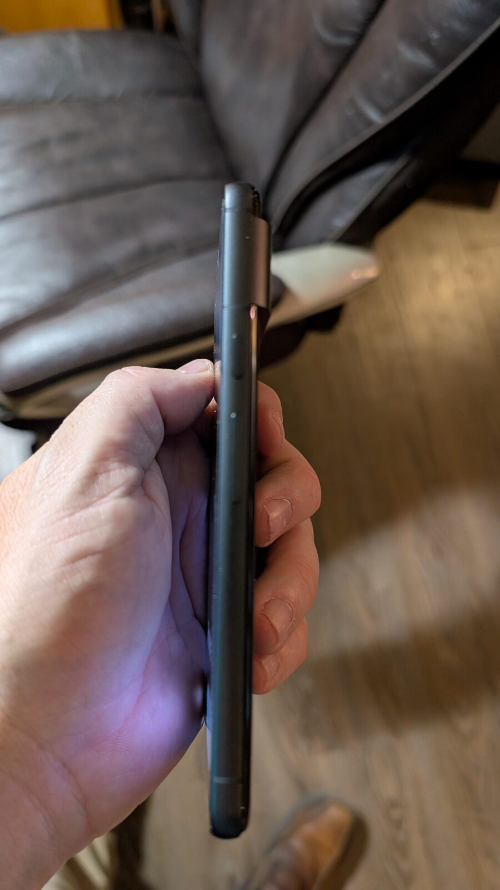
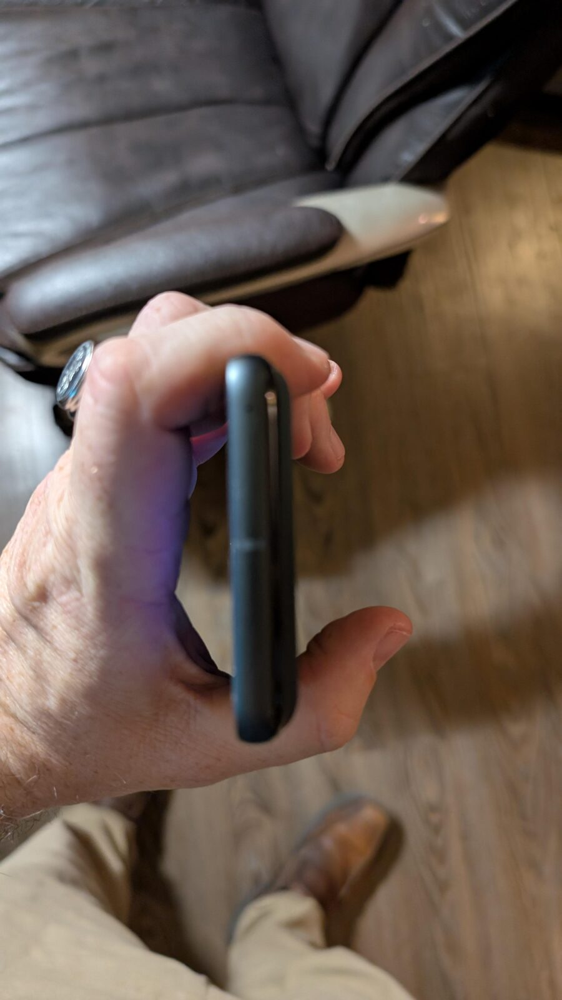
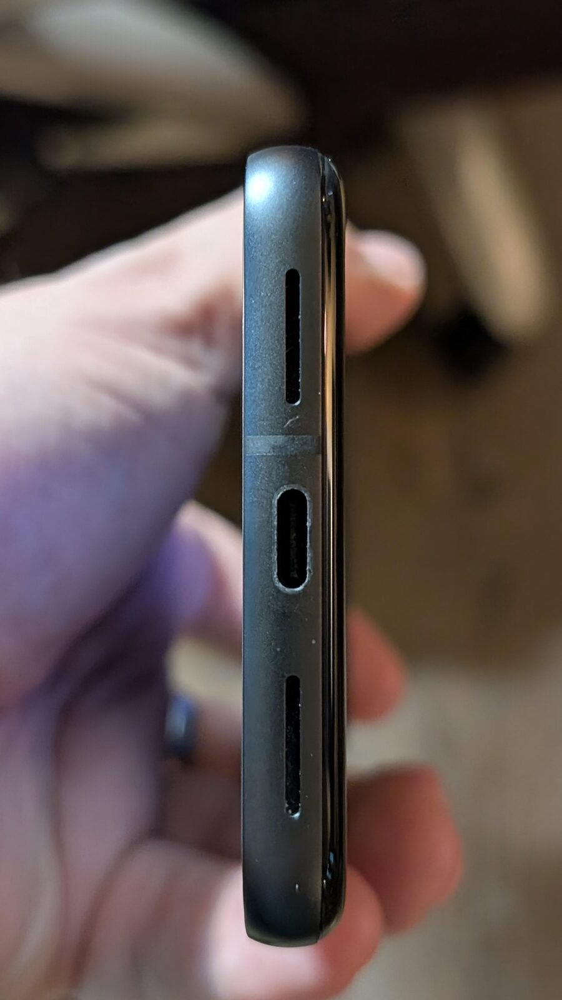
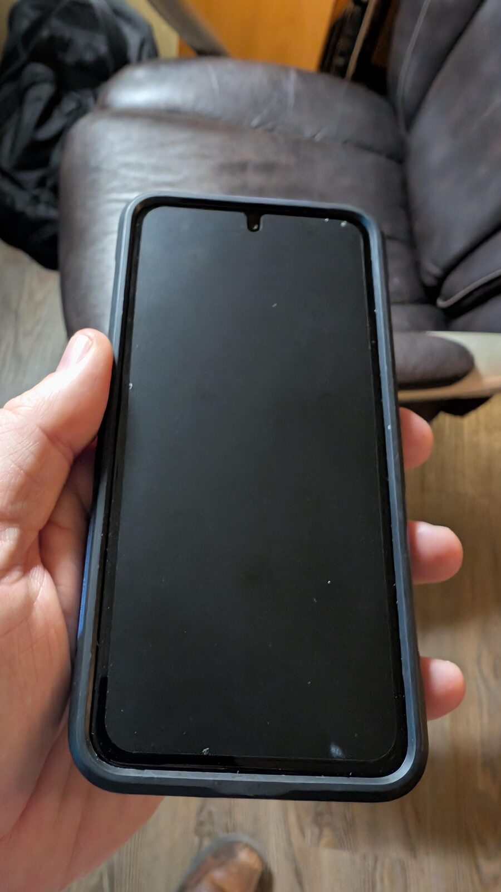
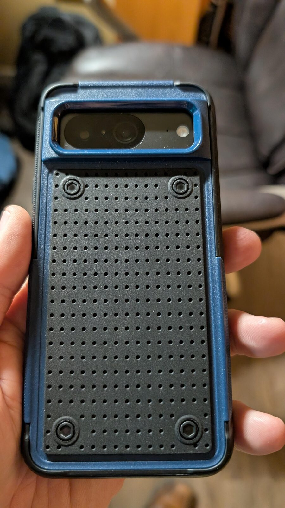

<strong>C$400 — local sale, Vancouver pickup only.</strong>

Google Pixel 8 128 GB in Obsidian, running stock Android. Matte screen protector fitted, no scratches on the screen, and the rugged case is included. Unlocked with no carrier or IMEI issues. No manufacturer warranty, but the original Best Buy receipt includes a transferable 3-year Best Buy Protection Plan valid to 16 August 2027.

For sale: a **Google Pixel 8 128 GB in Obsidian**, running **stock Android**. It has a **matte screen protector** fitted and the screen itself has **no scratches**. The **rugged case** shown in the photos is included.

There are no carrier restrictions and no IMEI issues. It will be **factory reset and signed out of Google** before handover.

## Why it is interesting

The Pixel 8 is a compact flagship with a **6.2-inch Actua OLED display at 120 Hz**, Google’s **Tensor G3** chip, 8 GB of RAM, and a 50 MP main camera. It is still supported by current Android releases, with 128 GB of storage.

## Hardware

| Component | Specification |
|---|---|
| Model | Google Pixel 8 |
| Storage | **128 GB** |
| Colour | **Obsidian** |
| Display | 6.2-inch Actua OLED, 120 Hz |
| Chip | Google Tensor G3 |
| Memory | 8 GB RAM |
| Rear cameras | 50 MP wide + 12 MP ultrawide |
| Front camera | 10.5 MP |
| Operating system | **Stock Android** |
| SIM | Nano-SIM + eSIM; unlocked, no carrier restrictions |
| Port | USB-C |
| Warranty | No manufacturer warranty; transferable Best Buy Protection Plan until 16 Aug 2027 |

## Condition

- **Screen:** matte screen protector fitted; **no scratches on the screen**.
- **Body:** clean, with no known damage; see the photos.
- **Software:** stock Android.
- **Carrier/IMEI:** no carrier restrictions and no IMEI issues.
- **Warranty:** no manufacturer warranty. The original Best Buy receipt includes a 3-year Best Buy Protection Plan, fully transferable at no cost, valid until **16 August 2027**.

## What is included

- Google Pixel 8 128 GB.
- Rugged case (shown in the photos).
- Fitted matte screen protector.
- No box, cable or charger.
- Factory reset and Google account removed before handover.
- Original purchase receipt available.
- Transferable Best Buy Protection Plan valid until **16 August 2027**; the buyer must contact Best Buy with the original receipt to complete the transfer.

## Purchase receipt

<figure class="pixel-receipt">
  
  <figcaption>Best Buy receipt, 16 August 2024 — Pixel 8 128 GB. IMEI and contract details redacted. The 3-year Best Buy Protection Plan is transferable at no cost and runs to 16 August 2027.</figcaption>
</figure>

## Price and pickup

<strong>C$400</strong>, local sale only. Pickup in Vancouver, BC.

Payment by PayPal G&amp;S, Interac e-transfer, or cash on pickup. Vancouver pickup only; no shipping.

The Best Buy Protection Plan transfers at no cost; I’ll provide the original receipt and help with the transfer.

If you want to see it working or check anything before buying, [get in touch](/contact/).

## Photos

  <figure>
    
    <figcaption>Front, screen on — “Hi there” setup screen.</figcaption>
  </figure>
  <figure>
    
    <figcaption>Front, screen off — matte protector, no screen scratches.</figcaption>
  </figure>
  <figure>
    
    <figcaption>Obsidian back, bare.</figcaption>
  </figure>
  <figure>
    
    <figcaption>Side profile.</figcaption>
  </figure>
  <figure>
    
    <figcaption>Side profile.</figcaption>
  </figure>
  <figure>
    
    <figcaption>Edge detail.</figcaption>
  </figure>
  <figure>
    
    <figcaption>Bottom edge — USB-C and speaker.</figcaption>
  </figure>
  <figure>
    
    <figcaption>Included rugged case, front.</figcaption>
  </figure>
  <figure>
    
    <figcaption>Included rugged case, back.</figcaption>
  </figure>

