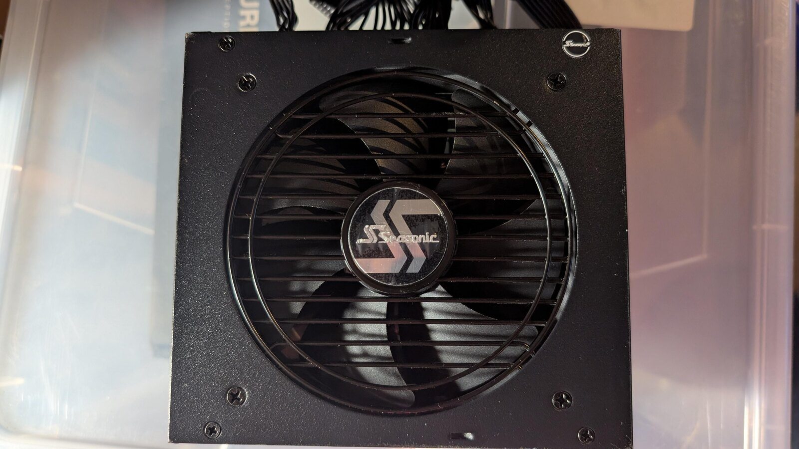
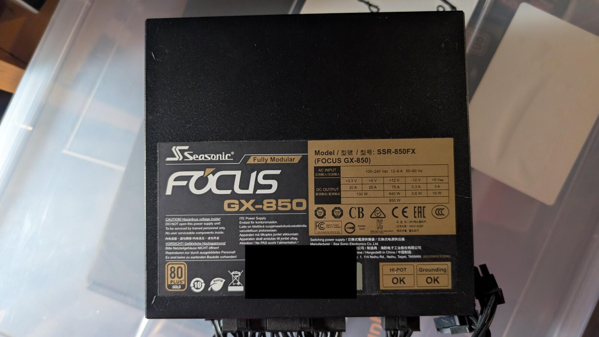
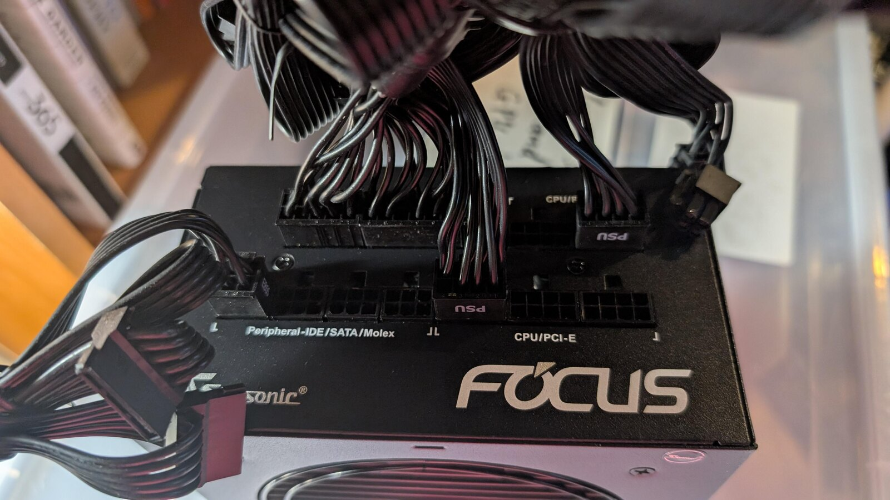
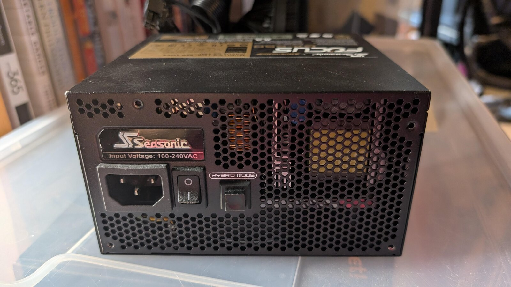

<strong>C$100 — Vancouver pickup.</strong>

Seasonic <strong>Focus GX-850</strong> (SSR-850FX): 850 W, 80 Plus Gold, fully modular, with the original modular cable set. Used; no retail box. Sold as-is with a <strong>7-day return if it does not power up</strong>.

For sale: a **Seasonic Focus GX-850** — the 850 W, 80 Plus Gold, fully modular unit from the Focus GX line. It is the SSR-850FX model, with the single +12 V rail, hybrid fan mode and the original black modular cables. It is a used unit from my parts stash, being sold because I no longer need it.

It is used, not new: there are light dust marks and normal handling marks, but no dents, cracked connectors or damaged cable ends. The retail box, manual and receipt are gone, so it is priced accordingly. If you need a modern ATX 3.x unit with a 12V-2x6 cable, this is not that generation — for a conventional 24-pin build it is a solid 850 W Gold unit.

## Specifications

| Item | Specification |
|---|---|
| Model | Seasonic Focus GX-850, SSR-850FX |
| Output | 850 W continuous |
| Efficiency | 80 Plus Gold |
| +12 V rail | 70 A / 840 W, single rail |
| AC input | 100–240 V, 50–60 Hz |
| Modularity | Fully modular |
| Fan | 120 mm fluid dynamic bearing, hybrid fan mode |
| Form factor | ATX, 140 mm deep |
| Protections | OPP, OVP, UVP, OCP, OTP, SCP |
| Warranty | Seasonic 10-year model warranty, but no box/receipt — treat as out of warranty in practice |

## Condition and what is included

- Used; sold as-is. I have not load-tested it since it came out of storage, so it is priced accordingly.
- Light dust and normal cosmetic marks; no dents or damaged connectors.
- **Original modular cable set included** — 24-pin ATX, CPU/EPS, PCIe, SATA and Molex cables. The photos show the bundle.
- **No retail box, manual or receipt.**
- 7-day return if it does not power up.

## Photos

  <figure>
    
    <figcaption>Fan side — Seasonic Focus GX-850.</figcaption>
  </figure>
  <figure>
    
    <figcaption>Specification label — SSR-850FX, 850 W, 80 Plus Gold.</figcaption>
  </figure>
  <figure>
    
    <figcaption>Modular cable side with the original cables.</figcaption>
  </figure>
  <figure>
    
    <figcaption>Rear — AC input, power switch and hybrid-mode switch.</figcaption>
  </figure>

## Price and pickup

<strong>C$100</strong> or nearest offer.

Vancouver pickup preferred; shipping at the buyer's expense. Payment by PayPal G&amp;S, Interac e-transfer, or cash on pickup.

If you want more photos, the cable count, or a photo of the connectors before buying, [get in touch](/contact/).
