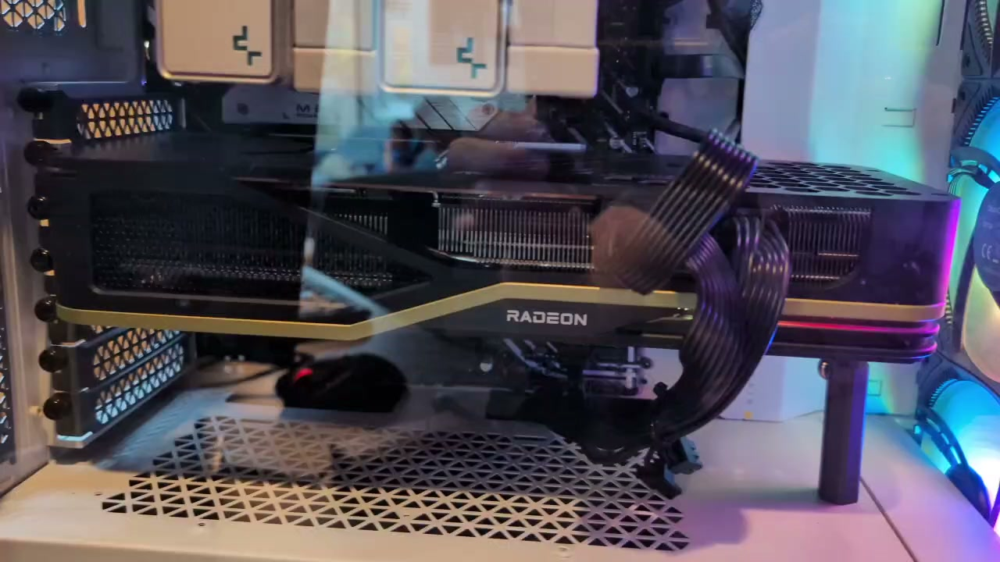
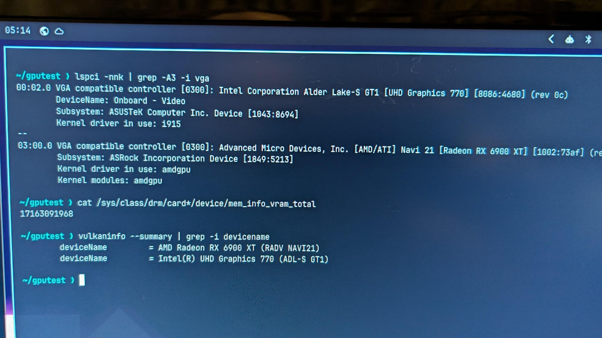

<strong>SOLD for C$350.</strong>

<strong>AMD Radeon RX 6900 XT</strong>, 16 GB GDDR6, factory-overclocked, three 8-pin power connectors, dual-BIOS. Sold as-is after disclosing that it detected fine but shut down once during a stress test while powered through a daisy-chained cable. Could be the cable setup, could be the card. The buyer had that disclosure, and the 7-day return still applied.

Listing closed. Thanks to everyone who expressed interest.

It would not fit in my Razer Core X eGPU enclosure — that has only two 8-pin connectors — so I needed a desktop to test it in.

I was getting ready to sell it to help fund other hardware. A working one was worth about **C$600**, so it was worth spending an afternoon proving it was healthy before listing it. The test found a problem. I listed it honestly as-is and sold it for **C$350**.

## The test setup

My son's PC, computer4, had an RX 6750 XT. I swapped the 6900 XT in and installed **Omarchy** (Arch + Hyprland) on the second drive. I unplugged his main drive during the install so there was no way to touch his system. A Bazzite live USB had shown a "no drivers" warning earlier; that was a red herring — AMD drivers are built into the Linux kernel.

Power came from a **be quiet! Pure Power 12 M 1000 W** (80 Plus Gold, ATX 3.x). The card was connected through a **daisy-chained 8-pin cable**. That detail matters, and I will come back to it. An older Seasonic Focus GX-850 was also on hand, but it was not the unit in use.

The plan was straightforward:

1. Confirm detection with `lspci`, `vulkaninfo` and the VRAM total in sysfs (should be 16 GB).
2. Watch `journalctl -k` for amdgpu errors and `amdgpu_top` for temperatures, clocks and power.
3. Run **memtest_vulkan** for 20–30 minutes.
4. Loop vkmark/glmark2 for 3D load.
5. Run llama.cpp on Vulkan with greedy sampling three times and diff the outputs; then `llama-bench` for sustained compute.

I was looking for edge temperatures under 85 °C, hotspot under 100 °C and memory under 95 °C.

## What happened

Detection was clean: the right model, 16 GB of VRAM, the amdgpu driver, and visible to Vulkan. Then, during **memtest_vulkan**, the whole PC powered off. Not a black screen, not a driver crash — the power cut out.

When I powered it back up, there was no display.

## Photos

  <figure>
    
    <figcaption>Installed in computer4 for testing.</figcaption>
  </figure>
  <figure>
    
    <figcaption>Detected correctly: RX 6900 XT, Navi 21, 16 GB of VRAM, visible to Vulkan.</figcaption>
  </figure>

## What it means

A sudden power-off under a memory stress test usually means the card pulled a burst of current, often from a failing memory chip or power stage, and the PSU's protection cut power. A modern 1000 W ATX 3.x supply should not trip on a healthy 6900 XT's power spikes. That, plus no picture afterwards, points at the card.

But I am not going to pretend that is proven. The card was on a daisy-chained cable, and I have not eliminated that. **It could be the cable setup, it could be the card.** I have not been able to fully retest it yet.

Before I listed it, the checks I would have done were: look and smell for scorching around the 8-pin sockets, try the other BIOS position and other outputs after a full power drain, retest with separate 8-pin cables, and put the 6750 XT back to confirm the PC was fine.

## The sale

It sold as-is for **C$350**, with the shutdown disclosed and the 7-day return I offered. I did not do the full retest before selling it; the buyer knew that. If it had passed a full retest, it would have been a working card at around **C$600**; if it had stayed dead, it would have been a **C$200 parts card**.

## What I would take away

1. **Test a used GPU under real load before selling or buying it.** A card that boots and shows a desktop can still be faulty.
2. **memtest_vulkan** is a quick, free VRAM test that runs on Linux and Windows.
3. A **deterministic llama.cpp run** — same prompt, compare outputs — is a neat compute-stability check.
4. **Rule out the PSU and cables first.** Older units can trip on RDNA2/RTX 30-series power spikes, and a daisy-chained cable is another variable.
5. **Install a test OS on a spare drive** with the main drive unplugged, so you cannot wipe someone else's system.
6. **Sell faulty cards honestly, as as-is or for parts.** Project buyers and repairers still pay, and a clear disclosure is better than a buyer discovering the problem later.

The step-by-step test plan is here: [Stress-testing a used GPU: Omarchy and the RX 6900 XT](/computer4-gpu-test-bench/).

I would rather sell a card with a clear disclosure than have someone find out the hard way. It has sold — thanks to everyone who expressed interest.
