

<strong>FOR SALE — C$1,100, local pickup only in Vancouver, BC.</strong>

ThinkPad T14 Gen 5 (21ML0055US) — Core Ultra 7 165U, 32 GB, 1 TB, 14-inch WUXGA touchscreen — freshly reinstalled with Windows 11 Pro and all current drivers loaded. In very good condition. Includes a laptop sleeve; no power adapter (it charges from any USB-C Power Delivery charger). Out of warranty and priced accordingly.

I am selling my **ThinkPad T14 Gen 5**. My portable machine is now a MacBook Pro, so this ThinkPad is looking for a new home. It is in **very good condition**.

It has just been **nuked and paved with a fresh Windows 11 install**, with the Intel Wi-Fi driver loaded from install media — this generation needs its LAN/Wi-Fi drivers supplied during setup, and that is already done, so it boots straight into a clean, ready-to-use system with networking working out of the box.

It was bought new from **Canada Computers** — ordered 21 September 2024, **C$3,209.17 including GST and BC PST** (invoice below).

## Why it is interesting

The T14 Gen 5 is **the last of the fully user-serviceable 14-inch ThinkPads**. The memory is **socketed — two DDR5 SODIMM slots, officially up to 64 GB** — and the storage is a standard **M.2 2280 SSD**, so a buyer can upgrade both for cheap instead of paying Lenovo's build-to-order prices. Newer machines moved to soldered memory; this generation did not.

It is also a classic ThinkPad in every other respect: the **best-in-class keyboard**, the TrackPoint, **MIL-STD-810H** durability testing, a serviceable hinge, and the usual excellent Linux support if you would rather wipe Windows entirely.

And this is the **well-specced configuration, not a base build**: the vPro-class **Core Ultra 7 165U** with Intel's integrated NPU, the 400-nit **WUXGA touchscreen**, **32 GB** of RAM and a **1 TB** SSD — the 16 GB / 256 GB builds which flood the refurb market are not this machine.

## Hardware

| Component | Specification |
|---|---|
| Model | Lenovo ThinkPad T14 Gen 5 (Intel) — **21ML0055US** |
| CPU | **Intel Core Ultra 7 165U** — 12 cores (2P + 8E + 2LPE) / 14 threads, up to 4.9 GHz, 12 MB cache, Intel vPro, integrated Intel AI Boost NPU |
| Memory | **32 GB DDR5-5600** — 2 × 16 GB SODIMM slots, upgradeable to 64 GB |
| Storage | **1 TB** M.2 2280 NVMe SSD (PCIe 4) |
| Display | 14-inch 16:10 WUXGA (1920 × 1200) **IPS touchscreen**, 400-nit anti-glare |
| Wireless | Intel Wi-Fi + Bluetooth (drivers pre-loaded on the fresh install) |
| Ports | 2 × Thunderbolt 4 (USB-C), 2 × USB-A, HDMI, 3.5 mm headphone jack |
| Keyboard | ThinkPad backlit keyboard with TrackPoint |
| Durability | MIL-STD-810H tested |
| Operating system | **Fresh Windows 11 Pro install, all drivers loaded** |

## Condition

- **Fresh Windows 11 install** — nuked and paved, drivers loaded, boots to a clean desktop with working Wi-Fi.
- **Body:** in **very good condition** — see the photos below.
- **Warranty:** out of warranty — expired, and the C$1,100 price reflects that. Buyers can confirm status themselves via Lenovo's public serial lookup.

## What is included

- ThinkPad T14 Gen 5.
- Laptop sleeve.
- **No power adapter or cable** — it charges from any USB-C Power Delivery charger you already own.
- Fresh Windows 11 install, ready to set up as your own.

## Purchase receipt

<figure class="t14-receipt">
  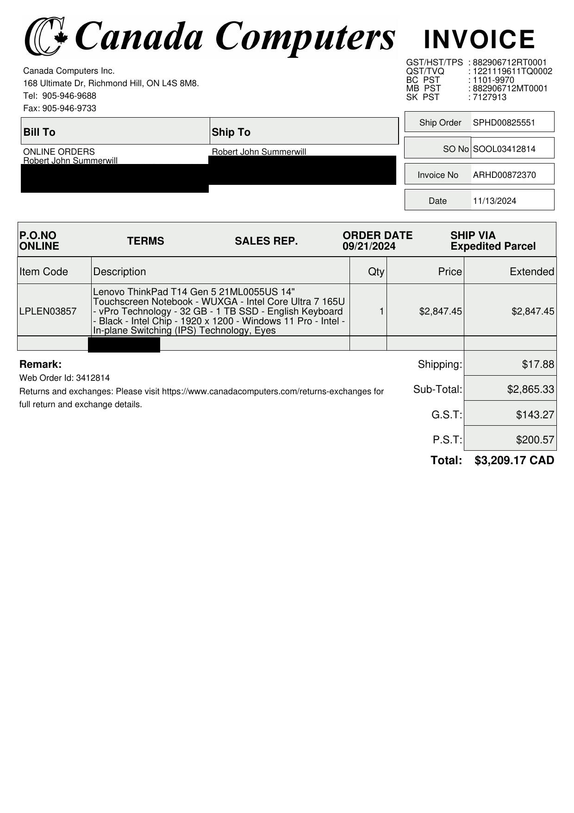
  <figcaption>Canada Computers invoice, 13 November 2024 — ThinkPad T14 Gen 5 (21ML0055US), C$3,209.17 including GST and BC PST. Bill To and Ship To addresses and phone redacted; serial number redacted.</figcaption>
</figure>

## Sale

**C$1,100** — firm; out of warranty, priced accordingly. Local pickup only in Vancouver, BC — **no shipping**.

- Payment by PayPal G&amp;S, Interac e-transfer, or cash on pickup
- Vancouver pickup only; no shipping
- First come, first served

## Photos

  <figure>
    <a href="/assets/thinkpad-t14-gen5/t14-01.jpg" target="_blank" rel="noopener">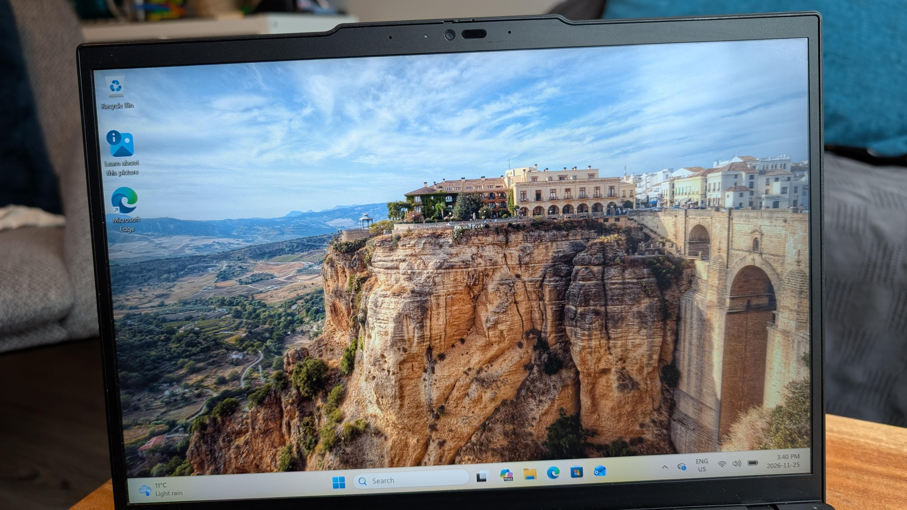</a>
    <figcaption>Photo 1 of 11.</figcaption>
  </figure>
  <figure>
    <a href="/assets/thinkpad-t14-gen5/t14-02.jpg" target="_blank" rel="noopener">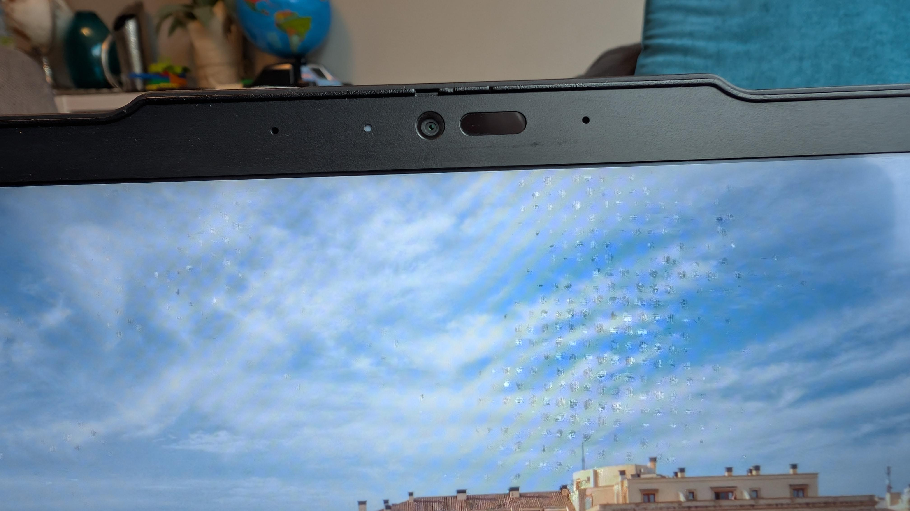</a>
    <figcaption>Photo 2 of 11.</figcaption>
  </figure>
  <figure>
    <a href="/assets/thinkpad-t14-gen5/t14-03.jpg" target="_blank" rel="noopener">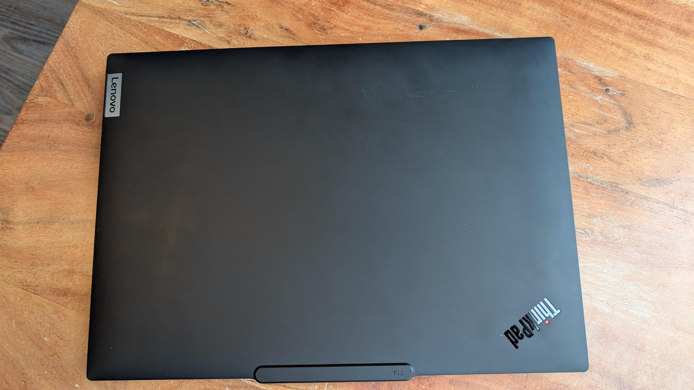</a>
    <figcaption>Photo 3 of 11.</figcaption>
  </figure>
  <figure>
    <a href="/assets/thinkpad-t14-gen5/t14-04.jpg" target="_blank" rel="noopener">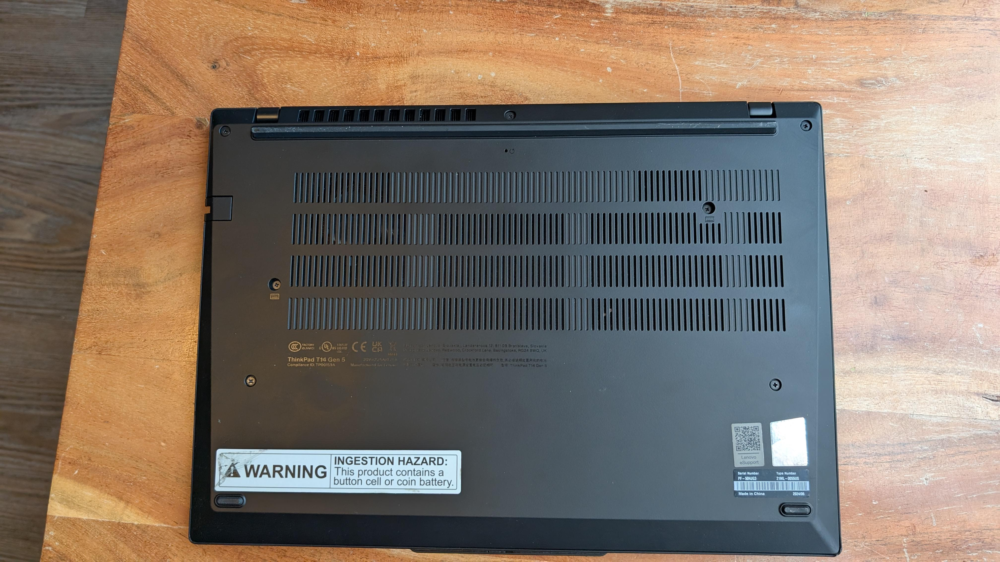</a>
    <figcaption>Photo 4 of 11.</figcaption>
  </figure>
  <figure>
    <a href="/assets/thinkpad-t14-gen5/t14-05.jpg" target="_blank" rel="noopener">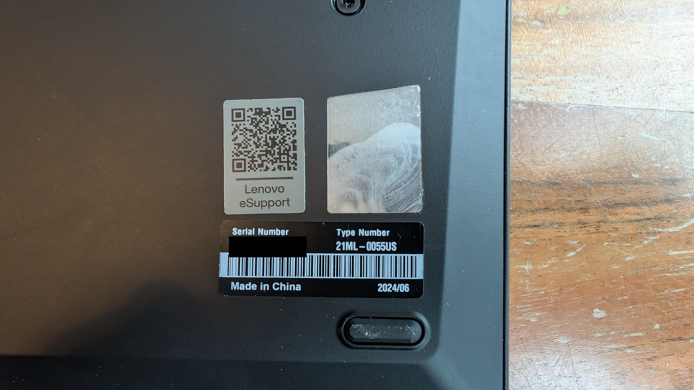</a>
    <figcaption>Bottom label — machine type 21ML0055US; serial number redacted.</figcaption>
  </figure>
  <figure>
    <a href="/assets/thinkpad-t14-gen5/t14-06.jpg" target="_blank" rel="noopener">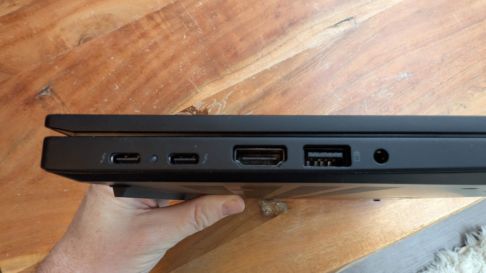</a>
    <figcaption>Photo 6 of 11.</figcaption>
  </figure>
  <figure>
    <a href="/assets/thinkpad-t14-gen5/t14-07.jpg" target="_blank" rel="noopener">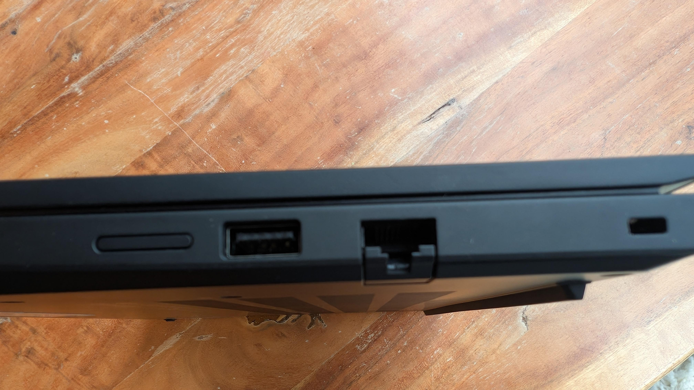</a>
    <figcaption>Photo 7 of 11.</figcaption>
  </figure>
  <figure>
    <a href="/assets/thinkpad-t14-gen5/t14-08.jpg" target="_blank" rel="noopener">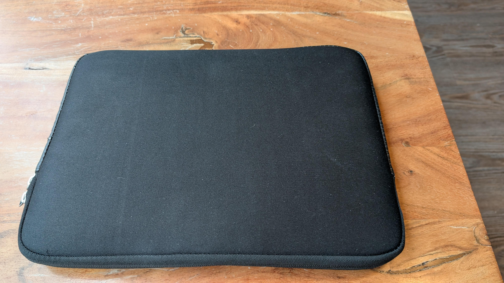</a>
    <figcaption>Photo 8 of 11.</figcaption>
  </figure>
  <figure>
    <a href="/assets/thinkpad-t14-gen5/t14-09.jpg" target="_blank" rel="noopener">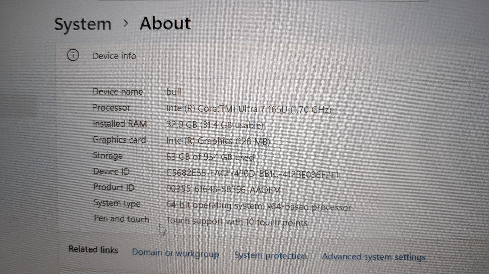</a>
    <figcaption>Photo 9 of 11.</figcaption>
  </figure>
  <figure>
    <a href="/assets/thinkpad-t14-gen5/t14-10.jpg" target="_blank" rel="noopener">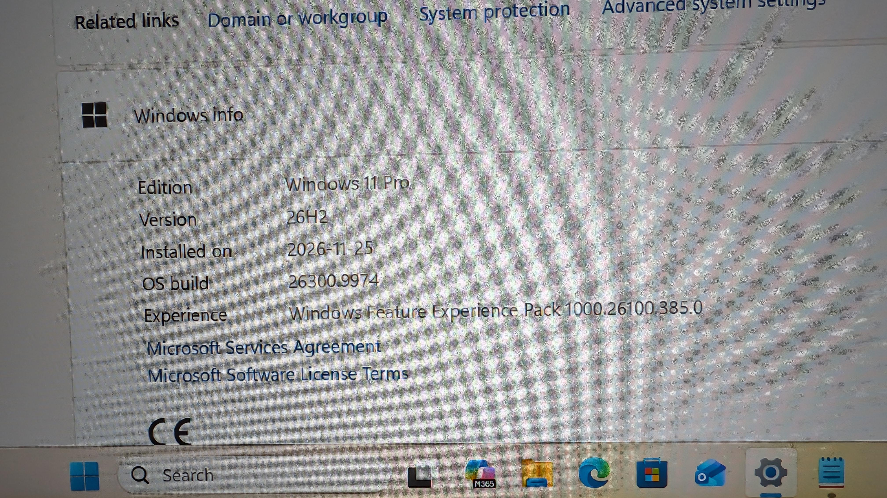</a>
    <figcaption>Photo 10 of 11.</figcaption>
  </figure>
  <figure>
    <a href="/assets/thinkpad-t14-gen5/t14-11.jpg" target="_blank" rel="noopener">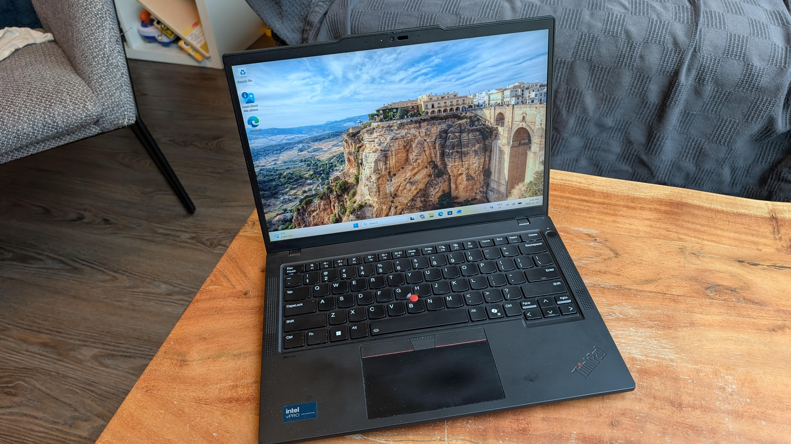</a>
    <figcaption>Photo 11 of 11.</figcaption>
  </figure>

